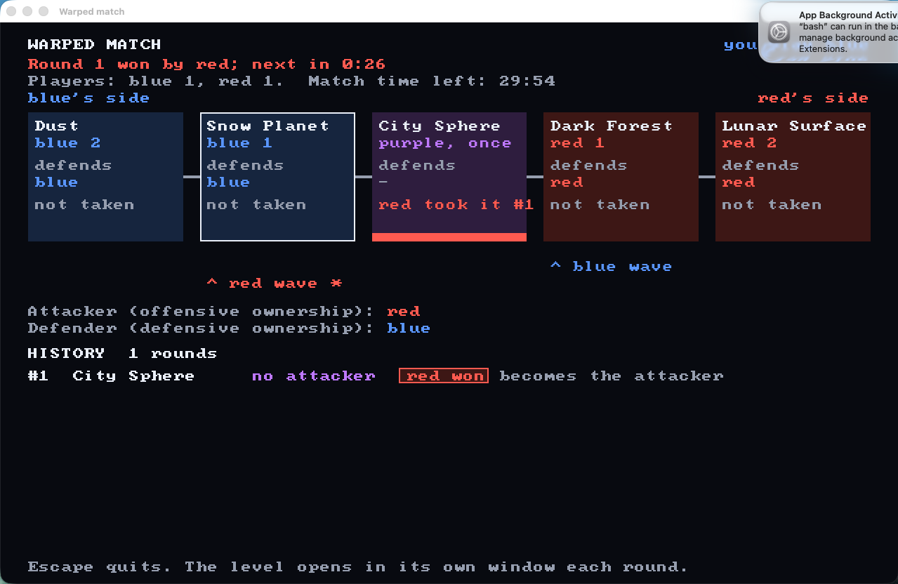

# Warped match (Rust)

The whole game end to end: a **match** across the five levels by the rules of
`game_design/DESIGN.md` (Match, Wavefront). A match server keeps the match state (every round
and its winner, each team's wavefront, offensive and defensive ownership, who attacks, the
result), starts each round's level as its own program, reads back which team won it, and shows
the progression in each player's match window. W-123.

It is a copy of `demos/hyperbolic_wormholes_rust/` (first commit on the branch, verbatim) plus
the match (`src/match_state.rs`, `src/match_flow.rs`, `src/match_menu.rs`, `match_levels.yaml`)
and the level interface below added to the copied level code. All five levels are real: Lunar
Surface is this copy; `make levels` builds the other four from this checkout's `demos/<level>_rust/`
(`LEVEL_SOURCE=checkout`, the default since they were merged into `staging/user-4gatepylon`), or from
their branches with `LEVEL_SOURCE=branches`.

## Play

```bash
export PATH="$(brew --prefix rustup)/bin:$PATH"
pushd demos/warped_match_rust
make serve-match                        # terminal 1: the match server (UDP 47850)
make join-match TEAM=blue               # terminal 2: blue's match window
make join-match TEAM=red                # terminal 3: red's (or: make bot-match TEAM=red)
popd
```

Alone, in one command: `make play-alone` (the match server, a bot on red that sits out every round
so rounds can start, and your window), or with bots: `make play-bots ALLIES=2 ENEMIES=3
BOT_OBJECTIVE=fight` (bots on your team and on the other, 0 to 5 and 0 to 6, since a level takes 12
players, 6 a team; `consoles` or `fight`), both `tools/play_with_bots.sh`, logs in
`.artifacts/play_with_bots/<run_id>/`. **Click a level on the progression page to play it now**
(free play on that level, round after round; the wavefronts still show the match's way); the
"back to the match" button or `M` goes back to the match. By hand: `make serve-match`,
`make join-match TEAM=blue`, `make bot-match TEAM=red`. The bot turns
off blue's consoles (10 s each, 3 on Lunar Surface), so be quick. From another Mac on the same
network: `make join-match SERVER=<server's address> TEAM=red`. Without `TEAM`, press 1 (blue) or
2 (red) in the match window.

A round starts 10 s after each team has a player. Each round opens the level in its own window,
joined to your team; a team wins it by turning off all of the other team's consoles. The level
stays open 5 s to show the win, closes, and the match window shows the progression until the next
round. `make e2e-match` plays a whole match of two bots with consoles off in 1 s, on `MATCH_PORT` and
`LEVEL_PORT` (48110 and 48112 by default), and writes its logs to `.artifacts/e2e_match/<run_id>/`.

`make play-all-levels` plays a bot match steered through all five levels and checks it
(`e2e/play_all_levels.py`): each bot gets `--bot-round-winners blue,blue,red,red,red` and joins no
level in the rounds its team should lose, so the rounds are City Sphere (blue), Dark Forest (blue
attacks and wins), Lunar Surface (red defends and wins), Snow Planet (red attacks and wins) and
Dust (red wins the match). It fails on a stall (a round over `--round-timeout-s`), a process that
stops early, or a round, level result file or outcome off that plan, and writes
`.artifacts/play_all_levels/<run>/`: `levels.log` (each level's start, winner and duration), the
match server's and both bots' logs, `summary.json` and `pictures/` (blue's progression page at each
round's start and at the end, `--progression-pictures` with `--match`). It uses UDP 48110 for the
match and 48112 for the levels (`MATCH_PORT`, `LEVEL_PORT`), away from a running match's. In Lunar
Surface, Snow Planet and Dust the bot walks to each pylon and its server takes a hold only from
within reach, so `levels.log` says when the bot reached each pylon on foot, and the test fails if it
didn't reach them all (W-126, same play in every level).

`make levels` puts each branch level in `.levels/<name>/` and builds it there; `match_levels.yaml`
reads `.levels/<name>/demos/<name>_rust/.build/release/<binary>` and its `map_picture`. The default
`LEVEL_SOURCE=checkout` makes `.levels/<name>` a symlink to this checkout, so the match builds and runs
`demos/<name>_rust/` from the same checkout (the levels are merged into `staging/user-4gatepylon`).
`LEVEL_SOURCE=branches` instead makes it a git worktree of the level's branch tip (`LEVEL_BRANCHES` in the
Makefile), for a level developed on its own branch. Switching modes needs `git worktree remove .levels/<name>`
first.

`play_all_levels.py`, `make e2e-match` and `tools/play_with_bots.sh` (`make play-alone`, `make play-bots`) run
everything with `WARPED_LOOPBACK_ONLY=1`: the match server, the level servers and the bots listen on 127.0.0.1
and send their announcements there instead of broadcasting them, so macOS never asks for network permission
(`warped_shared::network_scope`; `cargo test` is loopback-only by itself). `make serve-match` and
`make serve-game` leave it unset, so players on other computers find and join the game.

## The progression page



- The line of levels, blue's deepest on the left, `*` on the next round's level.
- Each level's place (`blue 2` … `purple` … `red 2`), its defender (defensive ownership) and its
  offence: whose wavefront it is, who captured it and in which round, or not reached.
- Both wavefronts, the attacker (offensive ownership) and defender now.
- The history of rounds: level, attacker, winner, and what it did (attacker advances, defender
  holds and roles swap). The result: a team wins, or a tie after 30 minutes.

## Match rules (`src/match_state.rs`)

Exactly `game_design/DESIGN.md`: round 1 is City Sphere with no attacker; its winner attacks. Each
team's wavefront starts at the other team's depth-1 level. An attacker that wins moves its
wavefront one level deeper, or wins the match on the defender's deepest level. A defender that
wins becomes the attacker, at its own wavefront (wavefronts never move back). City Sphere is
played once. 30 minutes without a winner is a tie. Unit tests: the design doc's worked example
row by row, and every win sequence up to 14 rounds (866) against a separate reading of the
rules.

## The one-window app and the game master

`../warped_mvp_rust/` (the official MVP) hosts and joins matches from one window. For it the match
server announces itself on UDP 47851 (a `WARPMTCH` beacon every 0.5 s: port, players per team,
phase, round), and takes a `play <level>` or `play match` datagram from any client (the game
master): free play on one level, round after round with each team's wins counted, or back to the
match where it was; either ends the round under way, and every client follows into the next. The
match's state, protocol and progression page live in `warped_shared` (`match_state`,
`match_protocol`, `match_menu`); this crate's files of those names re-export them.

## Level interface

Each level is a program that the match runs once per round. `match_levels.yaml` says which
program plays each level (`program: self` is this demo's binary, else a path from this folder)
and its `--map`. A level program implements:

```text
Server: <program> --serve --port <port> [--map <map>] --level-result-file <path> [server_args]
```

When one team has turned off every console of the other team, the server writes `<path>` once,
atomically (`<path>.partial`, then a rename): `{"winner": "blue"}` or `{"winner": "red"}`. It
does not start a new game after that; it keeps running (players see the win) until the match
server kills it.

```text
Client: <program> --join <address> --port <port> [--map <map>] --team blue|red [client_args]
Bot:    <program> --join <address> --port <port> [--map <map>] --team <team> --bot --bot-objective consoles --exit-after-s <s> --label <label>
```

`--team` joins that team at once, without the lobby. The match client kills the level when the
round ends, so a level needs no exit logic. `--bot-objective consoles` walks to the other team's
consoles in turn and holds `E` on each once in reach, until its team wins: in this copy (Lunar
Surface), Dust, Snow Planet and Dark Forest the server takes a hold only from within the settings'
`consoles.reach_m` of the console, aimed at it (`console_reach.rs`), so a bot win shows every
pylon can be reached on foot (`console_bot.rs`).

Ports: match server UDP 47850 (`--match-port`; 47851 reserved for its discovery, not used yet:
join by address); each round's level server 47852 (`--port` with `--serve-match`), and this copy's
level discovery 47853.

## The five levels (source of truth)

| # | Level | Side, depth | Pylons a team | Folder | Branch | In the match |
| --- | --- | --- | --- | --- | --- | --- |
| 1 | Dust | blue 2 | 3 | `demos/dust_rust/` | `devin/dust-demo` | plugged in (`make levels`) |
| 2 | Snow Planet | blue 1 | 2 | `demos/snow_planet_rust/` | `devin/snow-planet-demo` | plugged in (`make levels`) |
| 3 | City Sphere | purple 0 | 1 (on the glass, exposed) | `demos/city_sphere_rust/` | `devin/city-sphere-demo` | plugged in (`make levels`) |
| 4 | Dark Forest | red 1 | 2 | `demos/dark_forest_rust/` | `devin/dark-forest-demo` | plugged in (`make levels`) |
| 5 | Lunar Surface | red 2 | 3 | `demos/hyperbolic_wormholes_rust/` | `staging/user-4gatepylon` | playable (copied here) |

To plug a level in: add `<folder name>:<branch>` to `LEVEL_BRANCHES` in the `Makefile` (`make
levels` checks the branch out as a git worktree in `.levels/<folder name>/` and builds it there;
`make serve-match` runs it first), then in `match_levels.yaml` set the level's `program` to the
binary (e.g. `.levels/snow_planet/demos/snow_planet_rust/.build/release/snow-planet`) and `map`,
drop `stand_in_for`, and update this table. Set `takes_bot_label: false` if its bots don't take
`--label`. `make levels` follows each branch's tip, so run it again to pick up their changes.
Until a level is plugged in, `program: self` with `map: lunar-surface` and `stand_in_for: <level>`
plays it on Lunar Surface. `make progression-pictures WIDTH_PX=2560 HEIGHT_PX=1440` renders the progression page without a window for four match states (before round 1, mid-match, a sweep, a tie) into `.artifacts/progression_pictures/`. `map_picture: <png from this folder>` puts a picture of the level in its box on the progression page (the four branch levels commit theirs); this demo's own maps draw theirs from the map, and a level without one shows an empty box.

## Results

A bot match across all five real levels (`make e2e-match`, consoles off in 1 s) ended in 14
rounds, blue winning: City Sphere blue; Dark Forest and Snow Planet held by their defenders
for six rounds; Snow Planet red, then Dust held by blue three times; Dark Forest blue, Lunar
Surface blue. `make e2e-match` writes `.artifacts/match/<run>/match.json`
(rounds, winners, outcome) and each round's level server log.
After all four level branches took the first-to-finish console fix, three more bot matches all
finished with no stall: 3 rounds (blue), 6 rounds (blue: City Sphere blue, Dark Forest and Snow
Planet red, then Dust, Dark Forest and Lunar Surface blue) and 3 rounds (blue).
With the branch tips of 2026-11-08 14:06 UTC (Dust `3c23593`, Snow Planet `9095d1a`, City Sphere
`191b9d4`, Dark Forest `8f9b0ab`), a 9-round bot match ended with red winning, no stall.
With the tips of 14:50 UTC (Dust `91924f4`, Snow Planet `0d0e450`, City Sphere `ce2bdc2`, Dark
Forest `a6b3482`), a bot match ended in 3 rounds (red swept City Sphere, Snow Planet and Dust), no stall.
On `staging/user-4gatepylon` at `f1c57cd` (levels from this checkout), `make play-all-levels` passed all seven runs,
every level played, no stall, red winning in 5 rounds (Apple M3 Pro, macOS 15.7.3). Seconds from a round's
start to its win: City Sphere 1.2–1.4, Dark Forest 14.7–22.7 (its own console time; its bot opens a window), Lunar
Surface 3.3–4.0, Snow Planet 2.6–2.9, Dust 3.5–4.3 (consoles off in 1 s). With Dark Forest's client killed 6 s into
its round, the match client started it again and the round ended at 37 s. Pylons a team, counted as the consoles the
winner turned off (and the other team's with a lone bot): City Sphere 1, Dark Forest 2, Lunar Surface 3, Snow Planet
2, Dust 3, as `game_design/DESIGN.md` says. No level's console bot walked to a pylon then (each held `E` from where
it stood, and the servers took its word).

With walking console bots and the servers' reach check (W-126, same play in every level), `make play-all-levels`
passed five runs in a row (the last on `1aa771f`, with `staging/user-4gatepylon` merged in): Lunar Surface 35.9 s to
42.4 s, Snow Planet 13.0 s to 14.0 s and Dust 30.8 s to 40.6 s from a round's start to its win, every pylon reached on foot (City Sphere's and Dark Forest's own bots don't report their walks).
A lone walking bot of each team won each of those levels from its own spawn: Lunar Surface in 40 s (blue) and 42 s
(red), Dust in 33 s and 34 s, Snow Planet in 15 s and 13 s (Dust and Snow Planet after their W-126 parity changes);
the longest walk, to the farthest pylon (192 m to 204 m away), took 22 s to 25 s with up to 7 sidesteps along walls on
the way (Lunar Surface's hesco rows among them), the others 2 s to 10 s.

The match takes no pylon or console count: each level program has its own (the column above
follows `game_design/DESIGN.md`, 3-2-1-2-3 from the outside in) and reports only the winner.

## Performance

The match adds no rendering of its own: the match window is a text page, and each round's level
is its own program at its own frame rate (see each level's README for its numbers). Lunar Surface
is the hyperbolic demo's renderer unchanged, so its numbers there hold. On this session's Mac, a
virtual M4, `--bench-views --map lunar-surface --width-px 2560 --height-px 1440` took 19 to 164 GPU
ms a view, about five times the hyperbolic README's on a real Mac (blue spawn 45.5 against 8.4),
so its GPU can't judge the 16.7 ms target. City Sphere, opened by the match in a 1280x800 window,
showed 61 fps and 3.3 GPU ms.

## Files

- `src/match_state.rs`: the rules and the state; `src/match_flow.rs`: match server, protocol
  (`hello <team>` datagrams answered with the state as JSON), level processes;
  `src/match_menu.rs`: the progression page; `match_levels.yaml`: the levels.
- In the copied level code: `--level-result-file` (`net::write_level_result`), `--team`,
  `--bot-objective consoles` (`console_bot.rs`), the console reach check (`console_reach.rs`), hit
  pictures saved on their own thread (`picture_saver.rs`), `--serve-match`, `--match`.
- `e2e/`: settings and levels for the fast bot match.
- Everything else is the hyperbolic demo; see its README for the level itself. The files every Rust level
  shares are in [`../warped_shared_rust/`](../warped_shared_rust/README.md), a library this crate depends on.
