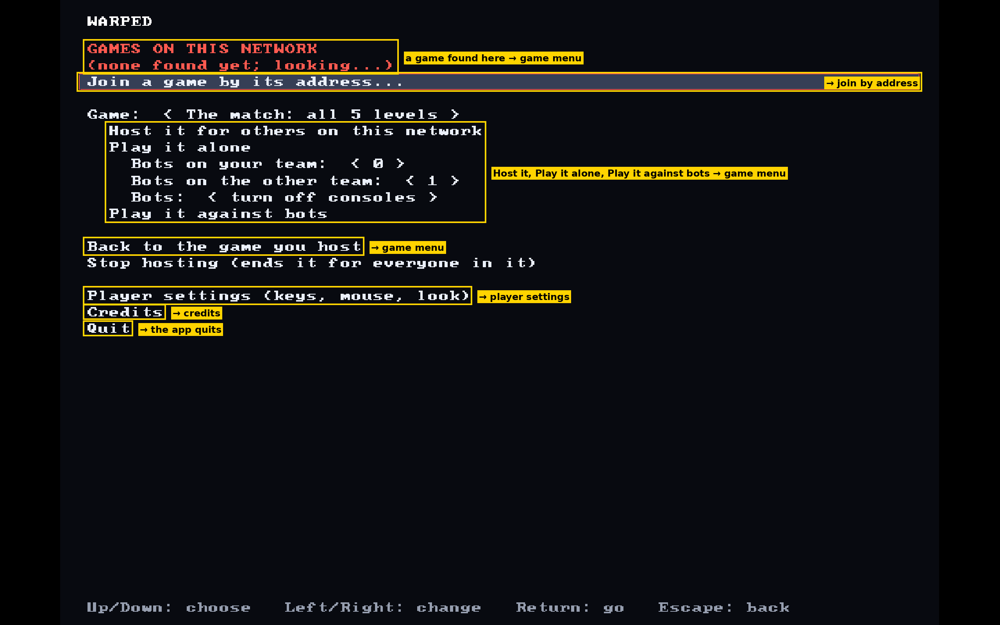
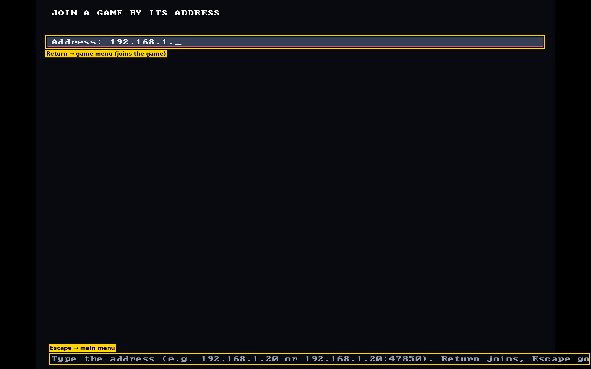
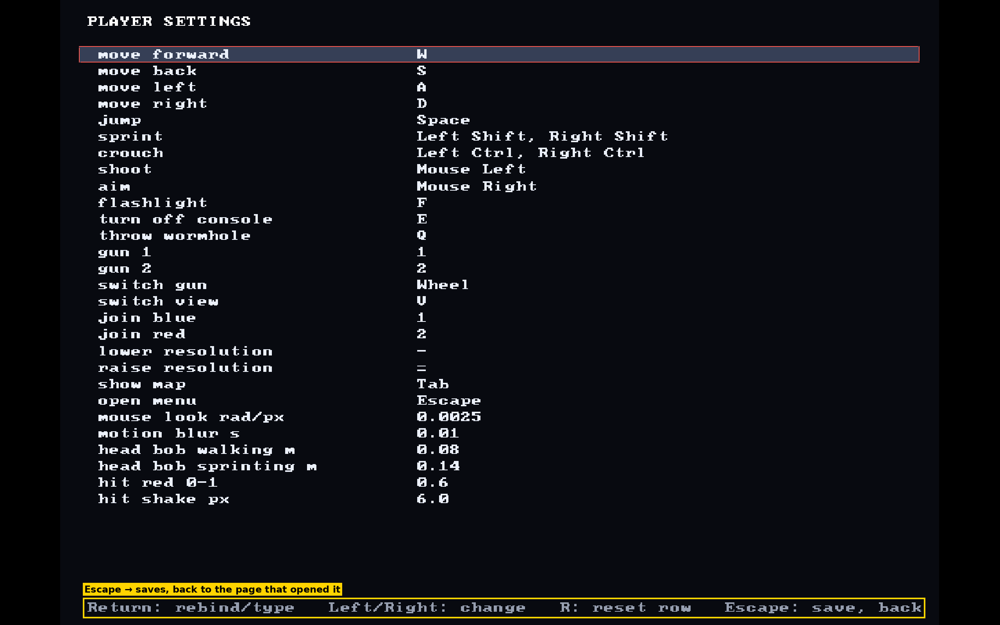
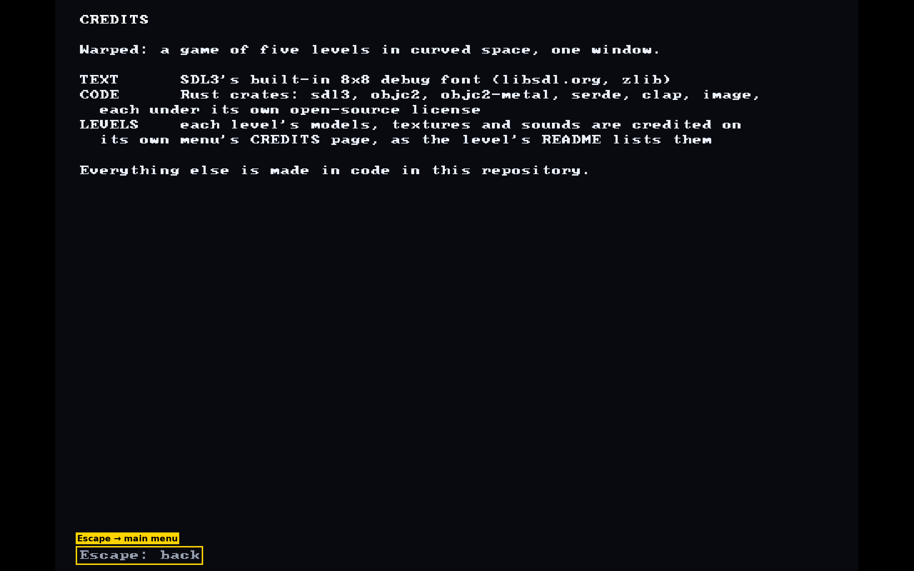
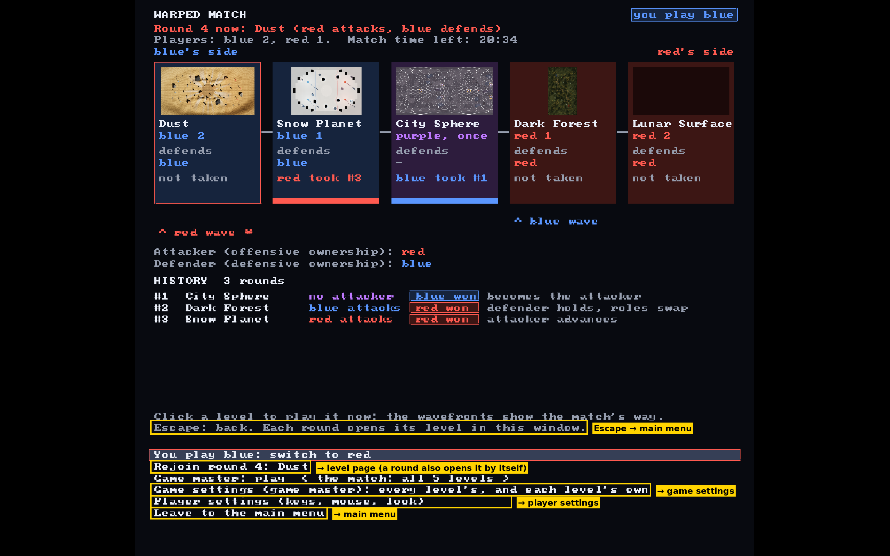
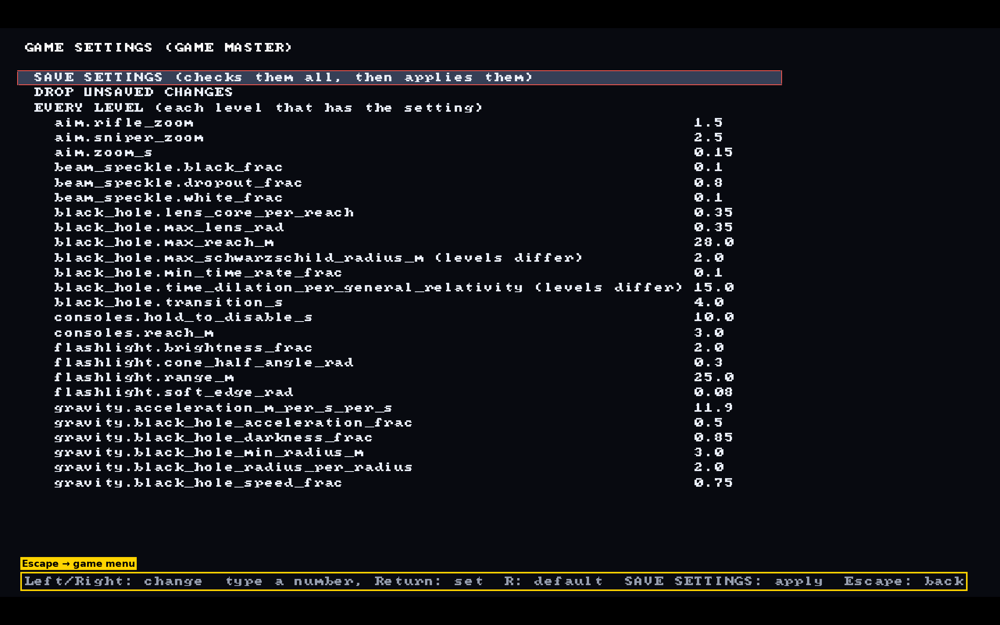
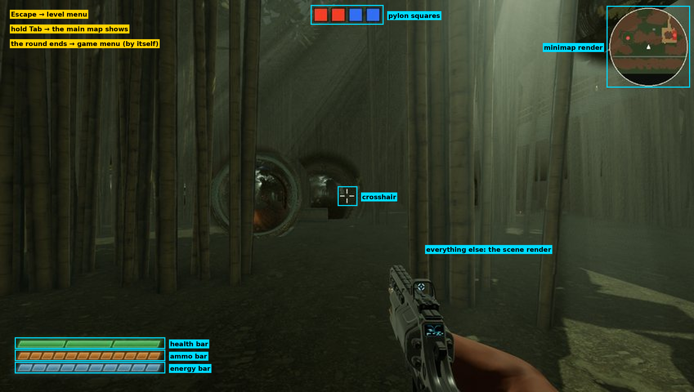

# Glossary

The official words of this project, one meaning each. Read "How to use it" first; the sections after it hold the
terms.

## How to use it

- **Official terms, always.** Every agent MUST use these terms exactly, in code, docs, commits and PRs.
- **The user may speak loosely.** The user may use a slightly different word for a thing. The third column of each
  table, "Might be called by the user", lists the ones we know. When the meaning is obvious from the context, read
  the user's word as the official term. When it isn't, ask the user a precise question: name the word, quote the
  sentence it came up in, give the meanings you see, and say which you would pick. Never write the loose word
  yourself.
- **New terms.** A term this file lacks needs the user's agreement. Ask, then add its row in the same change. Never
  invent or guess a term.
- **One meaning.** If two terms here seem to fit, or one term seems to mean two things, that is a mistake in this
  file. Ask the user, and fix it.

## Sections

- [How to use it](#how-to-use-it)
- [Structure of play](#structure-of-play)
- [People and entities](#people-and-entities)
- [Programs and places](#programs-and-places)
- [Pages and SWGs on the window](#pages-and-swgs-on-the-window)

## Structure of play

| Say | Meaning | Might be called by the user |
| --- | --- | --- |
| **game** | A game that exists but hasn't started: a game server hosts it, it has game settings and a choice of what to play (the whole map, or one level), and players join it and pick teams. | |
| **match** | A game that has started and is ongoing: two teams play across the levels of a map until a team wins it or it ties. Once it ends it is a *finished match*. | "game" |
| **free play** | A game or match on one level instead of the whole map. | |
| **round** | One play of one level during a match, which one team wins. | |
| **level** | One playable space: Dust, Snow Planet, City Sphere, Dark Forest or Lunar Surface. Each level has its own world. | "map", "demo" |
| **world** | A level's 3D game world: the place where its actual objects are, such as the ground, structures, pylons, warp objects and the sky. | "game world" |
| **map** | The line of levels a match is played across: the blue levels, one purple level in the middle, then the red levels. The default map has five levels. | |
| **level layout** | The data that says where one level's world has its ground, structures, spawns, pylons, warp objects, lights and sky, in the portable format of [`common/maps/`](../common/maps/README.md). | "map", "map file" |
| **map layout** | Several level layouts, plus the overall rules that join them into a map, such as which level leads to which. | |
| **depth** | How far a level is from the purple level: 0 for purple, then 1, 2, ... outward. | |
| **team** | Blue or red, about 5 players each. The purple level belongs to neither. | |
| **wavefront**, **attacker**, **defender** | A team's next level to win on the other team's side; the team whose wavefront is being played; the team that owns the level being played. Not built yet. | |
| **spawn** | Where a team's players enter a level. | |
| **zone** | One region of a level's world: the blue zone, the middle zone or the red zone. City Sphere has only a blue zone and a red zone. | |
| **boundary plane** | The faint see-through wall in a team's colour at the edge of its zone, which stops neither players nor lasers. In City Sphere it is a dome over each team's pylon. | "zone plane", "zone wall" |
| **route**, **floor** | One way across the middle zone; one walkable layer inside a level. | |
| **level edge** | The soft edge of a level, where players slow down without end as they climb, so they never leave. | "map edge" |
| **instance** | One particular copy of something that is defined once. Each hesco wall in a world is an instance of the hesco block structure, and a level being played in a round is an instance of that level. | |

## People and entities

| Say | Meaning | Might be called by the user |
| --- | --- | --- |
| **entity** | A thing in a world that acts, for a person or by itself: a player or a bot. Every entity has a sprite. | |
| **player** | The entity of a person who is playing. It has the bot sprite. | |
| **bot** | The entity the computer controls, on your team or the other. | "robot" |
| **sprite** | The visuals of an entity or an object: its shape and its **skin**, the colours and textures on it. | "skin" |
| **bot sprite** | The robot-shaped sprite that every player and every bot has, in its team's colour. | "robot", "robot sprite", "bot skin", "robot skin" |
| **game master** | The person who chooses what everyone plays and changes the game settings. | |
| **operator** | The person who runs a game server. | |
| **elimination** | A player or bot is hit enough to be out of health. It counts as a *death* for them and, when an enemy did it, a *kill* for the shooter. | "died", "killed" |
| **respawn** | An eliminated player's or bot's return, after the respawn time, on a ring around their team's spawn. | |
| **health** | What a hit takes away. | |
| **energy** | What sprinting uses up and time refills. | |
| **ammo** | What a gun uses when it fires. The sniper rifle holds one shot and reloads after it; the rifle heats up as it fires and cools down afterwards. Ammo never runs out for good. | |

## Programs and places

| Say | Meaning | Might be called by the user |
| --- | --- | --- |
| **the app** | The official game as one program with one window (`warped`, or `Warped.app` on a Mac). | Often called the `client` as well (as in server/client). |
| **window** | The operating-system window of the app. The official game has exactly one; older demos opened one per level and one for the match. The window is made up of pages (see [Pages and SWGs on the window](#pages-and-swgs-on-the-window)). | |
| **game server** | The headless program that hosts games and matches, and that players join. In the official game it is the program of `demos/warped_match_rust/`. | "match server" or "server" in the context of interactions in the world when using multiplayer. |
| **level server** | The headless program a game server starts to run one round's level: its players, bots, shots and consoles. This may not exist in the future | |
| **starter game** | The old 2D square game with its own `clients/starter/`, `game_server/` and `management_server/`. Historical, to be replaced soon. | "the 2D game" |
| **management server** | The starter game's program that starts game servers and tracks who may join them. A historical version exists, and a new version may be built in the future. | |
| **cloud** | Game servers on Google Cloud, with a download page ([`infra/`](../infra/README.md)). | |
| **demo** | A program built to test an idea. Older commits call each level and the match "demos". | |
| **library** | A Rust crate that levels share, such as `warped_shared`. | |

> NOTE: if any of this seems outdated, ask the user.

## Pages and SWGs on the window

Everything the player sees is on the window. The window shows **pages**, and what is on one page is that page's
**SWG**. This section has the terms, the pages tree, the page graph, the SWG model and each
page's SWG.

### Terms

| Say | Meaning | Might be called by the user |
| --- | --- | --- |
| **page** | Like a web page: one whole thing the window shows, such as the level page or a menu. Every menu is a page. A **sub-page** is a page inside another, such as the level menu's SCORES. | "screen" |
| **scene window graph (SWG)** | Pronounced "swig". A conceptual model of what is on a page: everything the player sees that is not part of the 3D world, as a tree like a web page's DOM. | |
| **render** | As a noun: a leaf of an SWG where the SWG stops and a "pure" graphical thing starts. As a verb: to show something on the screen, nothing more. | |
| **UIE** | A UI element, pronounced "ooh-wee": a leaf of an SWG that is a piece of the interface itself, such as a bar. | |
| **scene** | What a level's world looks like from the player's eye, or from behind and above in third person. | "level view" |
| **scene render** | The render of the scene: the rasterized representation of the match at the time of play, as you are playing it. | |
| **minimap render** | The render of the minimap. | |
| **HUD** | Heads-up display: the information a player sees while walking normally, on top of the scene render. It holds the bars, the minimap, the crosshair, the console bar, the pylon squares and the readouts. The main map is not part of it. | |
| **health bar**, **energy bar**, **ammo bar** | The HUD's bars, in the bottom left: health, sprint energy, and the ammo of the gun in hand. | "the bars" |
| **minimap** | A disk in a corner of the HUD (top right by default) that shows the ground within 60 m, with players as dots and shots as lines. | "mini map" |
| **crosshair** | The mark in the middle of the HUD. Shots leave the eye toward it. | |
| **console bar** | The bar below the crosshair that fills while the player holds `E` on a console. | |
| **pylon squares** | At the top centre of the HUD: one square per console of each team, an empty slot once it is turned off, and the **own-team box**, a box in the player's team colour around their own team's squares. | |
| **readouts** | The HUD's text lines of numbers, such as speed, height, or how fast the player's time runs near a black hole. | |
| **main menu** | The app's first page: the games on the network to join, joining by an address, hosting, playing alone or against bots, what to play, player settings, credits, quit. | "title screen" |
| **game menu** | The app's page around a game or match: its status, your team, rejoining, the game master's choice, game settings, player settings, leaving to the main menu. | |
| **level page** | The page you play in. Its SWG has the scene render, the actual render of the level's world. | |
| **level menu** | The page `Esc` opens over the level page, with the sub-pages MATCH, SCORES, SETTINGS, MAP, CREDITS and QUIT. The player stands still while it is open, and the game goes on. | "the menu", "in-level menu", "in-game menu" |
| **main map** | The picture of the whole level from above, as opposed to the minimap. It is a hidden part of the level page's SWG, shown while `Tab` is held, and the level menu's MAP sub-page shows it too. | "the map", "in-game map", "map page" |
| **game settings** | The game master's settings of a game, a sub-page of the game menu. The file stays `server_settings.yaml`. | "server settings" |
| **player settings** | A player's own keys and view, a sub-page of every menu. The file is `player_settings.yaml`. | |
| **lobby** | The page of a level run alone, outside the app, where a player picks a team: it says CONNECTING, then CONNECTED with each team's head count. In the app, the team is chosen on the game menu. | "team screen" |
| **banner** | A message over the scene render: YOU DIED with a countdown, `<TEAM> TEAM WINS`, LOADING before a level's first frame, and the connection messages. | |
| **window title** | The text in the window's title bar: the frame rate, the render time, the GPU's time and the render scale. | |
| **tooltip** | The help the level menu's `?` shows while the mouse is over it. | |

> NOTE: We may call things that appear over the level page "in-game", such as the "in-game menu" (the level menu) or
> the "in-game map" (the main map, on `Tab`). That wording is not correct: a game is one that hasn't started. Read
> it as the official term, and never write it.

### The pages tree

The app's pages, each under the page it belongs to. The tree has only pages: what is on a page is its SWG, below.

```text
window
├── main menu
│   ├── join by address
│   ├── player settings
│   └── credits
├── game menu
│   ├── game settings
│   └── player settings
├── level page
└── level menu
    └── player settings
```

### The page graph

Which pages each page leads to, and how, from the app's own navigation code (`demos/warped_mvp_rust/src/screens.rs`
and `app_state.rs`):

| From | To |
| --- | --- |
| main menu | join by address, player settings, credits; game menu (join a game it found, host one, play alone or against bots, or go back to the game this app hosts); the app quits (Quit) |
| join by address | game menu (Return joins the game); main menu (`Esc`) |
| player settings | the page that opened it (`Esc`, which saves) |
| credits | main menu (`Esc`) |
| game menu | level page (by itself, when a round is played and you have a team, or after Rejoin); game settings, player settings; main menu (`Esc`, or Leave) |
| game settings | game menu (`Esc`) |
| level page | level menu (`Esc`); game menu (by itself, when the round ends) |
| level menu | level page (`Esc`, or Resume); player settings; game menu (Exit to the game menu); the app quits (Quit Warped) |

`Esc` never quits the app: quitting is a row of the main menu and of the level menu. Each page's SWG below has a
picture of the page that marks which row or key leads to which page.

### The SWG model

> NOTE: The SWG is terminology and a mental model only. There is no SWG file and no SWG code, on purpose. Later we
> may define SWGs more formally, with an SWG language, YAML or another format. Until the user asks for that, don't
> create one.

1. **What it holds.** Everything on a page that is visualized and is not part of the 3D world is part of the page's
   SWG.
2. **A tree.** An SWG is a tree of nodes, as a web page's DOM is.
3. **Only leaves are rendered.** Leaf nodes are shown on the screen, and every other node groups its children.
4. **A leaf is a render or a UIE.** Always one of the two.
5. **Offsets.** Conceptually, each leaf has an offset from its parent along the `z` axis (depth) as well as the `x`
   and `y` axes. They could be relative or absolute coordinates, as in CSS, but we don't handle that yet.
6. **Shared depth, by design.** Nodes can have any such offsets, but it is almost always recommended, and designed,
   that the UIEs and renders of a group share a similar `z`: the HUD's leaves all have the same `z`, and the HUD is
   on top of the scene render.
7. **Hidden parts.** A part of an SWG can be hidden until something shows it, as the main map is.
8. **One SWG per page.** Each page has its own SWG. Leaving the level page for the game menu leaves one SWG for
   another.

### The main menu's SWG

```text
main menu
├── title                                       UIE
├── games on this network: a row per game       UIEs
├── rows                                        UIEs
├── selected-row highlight                      UIE
├── message                                     UIE, hidden until an action fails
└── help line                                   UIE
```



### The join by address page's SWG

```text
join by address
├── title                                       UIE
├── address field                               UIE
├── message                                     UIE, hidden until joining fails
└── help line                                   UIE
```



### The player settings page's SWG

```text
player settings
├── title                                       UIE
├── a row per key or view setting               UIEs
├── selected-row highlight                      UIE
└── help line                                   UIE
```



### The credits page's SWG

```text
credits
├── title                                       UIE
├── credits text                                UIEs
└── help line                                   UIE
```



### The game menu's SWG

```text
game menu
├── match status
│   ├── title, round, players, time left        UIEs
│   ├── a card per level
│   │   ├── map picture                         render
│   │   └── name, team, defender, taken by      UIEs
│   ├── waves, attacker and defender            UIEs
│   ├── history                                 UIEs
│   └── footer                                  UIEs
├── rows                                        UIEs
├── selected-row highlight                      UIE
└── message                                     UIE, hidden until an action fails
```



### The game settings page's SWG

```text
game settings
├── title                                       UIE
├── SAVE SETTINGS, DROP UNSAVED CHANGES         UIEs
├── a section per scope (every level, each level only)
│   ├── heading                                 UIE
│   └── a row per setting: name and value       UIEs
├── selected-row highlight                      UIE
├── message                                     UIE, hidden until the server refuses the settings
└── help line                                   UIE
```



### The level page's SWG

```text
level page
├── scene render                                render
├── HUD
│   ├── minimap render                          render
│   ├── health bar, energy bar, ammo bar        UIEs
│   └── crosshair, console bar, pylon squares, readouts   UIEs
├── banner                                      UIE
└── main map                                    hidden until `Tab`
```

The 3D world itself (the bots, lasers, pylons, wormholes and the rest) is not in the SWG: the scene render is the
picture of it. The picture is Dark Forest run as its own program (`game_design/slides/images/forest_hud.jpg`); the
console bar, the readouts and the banner aren't on it.


