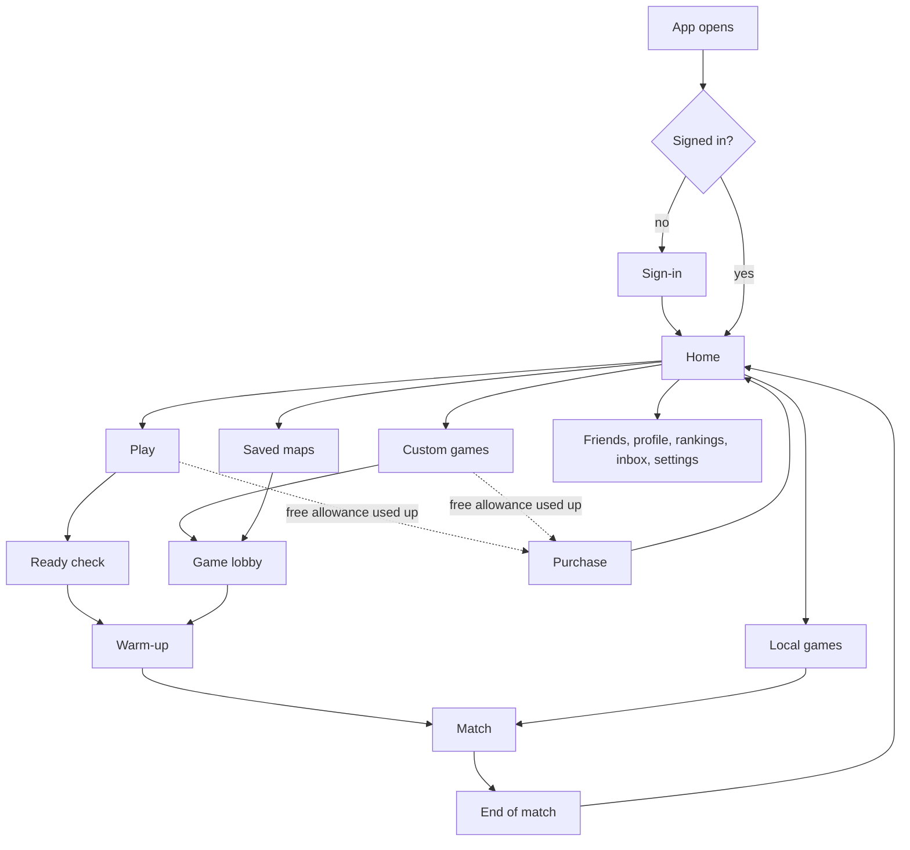

# Warped window design

This document describes the app's windows: which windows there are, how a player gets from one to the next, what
each shows, which settings it has and who may change them. [`INSIDE_GAME_DESIGN.md`](INSIDE_GAME_DESIGN.md) describes
what a player sees and does while playing a match, and [`OUTSIDE_GAME_DESIGN.md`](OUTSIDE_GAME_DESIGN.md) the rules
that the windows outside a match carry out.

- **≈** marks a first guess, to be tuned in playtests.
- **TBD** marks something not designed yet.
- **Not built yet** marks a window that is designed but that the Rust game doesn't have yet.

## The windows today

The windows a player meets, in order: the title, the loading screen, the lobby, the match itself
([`INSIDE_GAME_DESIGN.md`](INSIDE_GAME_DESIGN.md#screen)), and the menu, which opens over the match.

- **Title** (the Mac app, opened without flags): a list of the online games on the server the app was built for,
  joining a server by the address the player types (its IP and port, remembered for next time), joining a game on
  this Wi-Fi, and Quit, each game on either map. A game on a server asks once for its password (empty for a
  server without one) and keeps it; a server that refuses it, or runs another version, stops the window with a
  pop-up saying why, and the title screen comes back.
- **Loading:** before the first frame, a black screen titled LOADING names what is loading (the surface textures,
  the shaders, each gun) over a bar like the console bar, filling as it goes.
- **Lobby** (the team screen): it says CONNECTING until the server answers, then CONNECTED with how many players
  each team has. `1` joins blue and `2` joins red; it then says JOINING THE GAME until the server lets the player
  in. A player can't shoot from the lobby.
- **Connection banners:** when a window can't play on its server, a banner says why, and the terminal says what to
  do:
  - NO ANSWER FROM THE SERVER: nothing came back for 2 s;
  - SERVER RUNS ANOTHER VERSION: the server's messages don't fit this build, so rebuild both from the same commit;
  - THE GAME IS FULL: the server already has 12 players.
- **Exit:** `Esc` opens the menu; on its QUIT page (`Q` from SCORES, where it opens) "Do you want to leave the
  game?" leaves with `Return` or `Y`, and `Esc` goes back to the game.

### The menu

- **Menu** (`Esc`, which frees the mouse; `Esc` again closes it and captures the mouse): its name on the first line,
  the names of its five pages on the line under it (the open one in brackets), then the page. It opens on SCORES.
  The left and right arrows, `Q` and `E`, or a click on a page's name turn the pages. On SETTINGS, `Down` or `Up`
  goes from the pages' names into the rows, where the left and right arrows change the chosen number instead, and
  past the first or last row comes back to the names. A `?` at the right of the first line shows the menu's keys
  while the mouse is over it; the keys aren't shown otherwise. Inside the one-window app a sixth page, MATCH, comes
  first, with the match's status (the current level, the round, which team attacks and the scores), and the menu
  opens on it. Inside the menu the arrows, `Return`, `Esc`, `Q` and `E` always work, whatever the key
  bindings say, so a bad binding can always be fixed. The player stands still while it is open,
  but the game goes on.
  - SCORES: the player count, and each player's team, kills and deaths in this game, sorted by
    team and then kills, with the player's own line marked and each team's totals. Before a game
    on a server it says there is none, and before the server's first scores it says to join a team.
  - SETTINGS: the player's own settings, one row each: every key binding (`Return`, then the new
    key, button or wheel; `Esc` cancels), then numbers changed with `Left` and `Right` (mouse look
    speed, motion blur, head bob walking and sprinting, how red, shaky and blurred a hit looks,
    the wormhole colour's strength, the Milky Way's brightness, and the picture's brightness,
    contrast, saturation and gamma, which change only how the finished picture looks on that
    player's screen, W-51, basic visuals), then a row that saves them to
    `~/.config/warped/player_settings.yaml` (or the `--player-settings` file), which later games
    load. A line below says what changed or went wrong.
  - MAP: the whole level from above, with the ground's relief, structures, consoles, wormhole
    mouths, the black hole, the spawns, the zones' edges and the map edge, the player as a disk
    pointing the way they face, a circle of the minimap's reach around them (the rest darker and
    blurred), and every other player in the game, near or far, as a dot in their team's colour.
    A legend line names the marks.
  - CREDITS: where the game's assets come from (their authors, sources and licenses), the font
    and the libraries the game is built on.
  - QUIT: "Do you want to leave the game?"; `Return` or `Y` leaves it (a level run alone quits; the one-window app
    goes back to its game menu), and `Esc` goes back to the game.

## The windows to come

**Not built yet**, all of this section. These windows carry out the rules of
[`OUTSIDE_GAME_DESIGN.md`](OUTSIDE_GAME_DESIGN.md), and each one names the section it serves.

### How a player moves between them

Home takes the title screen's place. The friends panel, the inbox and the party stay within reach from every
window outside a match.

### Sign-in

Serves [Accounts](OUTSIDE_GAME_DESIGN.md#accounts).

- A "Sign in with Google" button, which opens the browser and comes back signed in.
- The first time: the birth date, the display name, an icon from the set, and the terms to accept.
- A player who isn't signed in can still open Local games.

### Home

- **Play**, **Custom games**, **Saved maps** and **Local games**, each opening its window.
- The player's name, icon and tier, which open their profile.
- The newest announcement, and a banner while the servers are in maintenance.
- The party, when the player is in one, and the queue's timer while it searches.

### Purchase

Serves [Paying](OUTSIDE_GAME_DESIGN.md#paying).

- It opens when a player past their free allowance tries to play online. It says what the purchase unlocks and
  its price, and a button opens the payment page in the browser.
- It closes by itself when the payment is confirmed. Local games stay open from it.

### Play

Serves [Matchmaking](OUTSIDE_GAME_DESIGN.md#matchmaking).

- The party's players with their tiers, and a button to invite more.
- Each region with the app's delay to it.
- **Find a match**, which only the party's leader presses. While it searches: the time waited, the estimated
  wait, and a button to stop.
- The offer of a match with bots, when it comes, with how many human players it would have. Each player of the
  party answers.
- **Ready check:** a window over everything else, with a sound, a ≈20 s countdown and one button to confirm.
- The player's place in the wait queue, while the caps are full.
- A cooldown, when the player has one, with the time left in place of the button.

### Custom games

Serves [Custom games](OUTSIDE_GAME_DESIGN.md#custom-games).

- **The list** of listed games: name, saved map, region and delay, players in it, and a lock for a password. The
  player filters and sorts it, or types a game's code.
- **New game:** the saved map to start from, the game's name, its region, and the settings of
  [Who gets in](OUTSIDE_GAME_DESIGN.md#who-gets-in). Starting it opens its lobby.
- **Stopped games:** the player's games that kept a checkpoint, each with a button to start it again.

### Game lobby

The lobby of today, grown for custom and tournament games.

- **Everyone sees:** both teams and who is on them, with a button to join each; the game's saved map and
  settings, read-only; the lobby's chat; the game's link and code; and, in the warm-up, its timer and the levels to
  jump to.
- **Admins also see** the admin panel:

  | Part | What an admin does there |
  | --- | --- |
  | Players | Kick a player, with or without banning them from this game. |
  | Access | Set the password, the whitelist, the ban list, the most players and whether the game is listed. |
  | Game settings | Change the game settings for the matches still to come. |
  | Watching | Turn watching on or off, set its delay, and choose who may watch. |
  | Admins | Add and remove admins. |
  | Match | Start the match and stop it. Only the root admin closes the game. |

- In a matchmade match the lobby has no admin panel and no team buttons: matchmaking set the teams.

### Saved maps

Serves [Saved maps](OUTSIDE_GAME_DESIGN.md#saved-maps).

- **The list:** the player's own saved maps, those shared with them and the public ones, each with its creator and
  the player's role on it. A reader starts a game from one or copies it.
- **The editor**, for writers:
  - the levels, picked from the game's levels and dragged into order;
  - the game settings, one row each as on the menu's SETTINGS page, in a part shared by every level and a part
    per level, each row with its official value and a button back to it.
- **Sharing**, for admins: the visibility, and the players it is shared with and each one's role.

### In a match

The menu of today gains, in online matches:

- on SCORES, next to each player: mute, block, report, and after the match commend;
- a VOTE page in ranked matches: kick a teammate (with the reason), surrender, pause;
- on QUIT in a ranked match, what leaving will cost: the loss and the cooldown, or nothing if a teammate already
  abandoned.

A player who dropped out of a ranked match gets a **Rejoin** window when the app is back, with the time left.

### End of match

- The result, both teams, and each player's kills and deaths.
- In a ranked match: how the player's rating and tier changed, or the placement count.
- Buttons to commend and report players, watch the replay, queue again with the same party, and go Home.

### Watching and replays

Serve [Watching](OUTSIDE_GAME_DESIGN.md#watching) and [Replays and clips](OUTSIDE_GAME_DESIGN.md#replays-and-clips).

- **Spectator view:** the match with a free camera, a list of players to follow, the scores, and the delay it is
  shown with. It has no chat to the players.
- **Replay viewer:** the same view with a timeline to move along, the speed, and marks at eliminations and at
  each round's end. A player of the match gets **Make a clip** (mark a start and an end) and **Copy link**.

### Friends, chat and clans

Serve [Friends, parties and clans](OUTSIDE_GAME_DESIGN.md#friends-parties-and-clans) and
[Talking](OUTSIDE_GAME_DESIGN.md#talking).

- A panel at the side of every window outside a match: friends with their presence, requests, recent players, the
  party and the clan.
- A chat with tabs, one per channel the player is in.
- Clicking a player anywhere offers: profile, message, invite to the party or game, add friend, mute, block,
  report.

### Profile, match history and rankings

Serve [Profiles](OUTSIDE_GAME_DESIGN.md#profiles), [Match history](OUTSIDE_GAME_DESIGN.md#match-history) and
[Rankings](OUTSIDE_GAME_DESIGN.md#rankings).

- **Profile:** what the profile shows, as much as its owner allows the viewer.
- **Match history:** the list of matches, each opening its scores and its replay.
- **Rankings:** everyone, friends, or the clan, with the player's own line marked.

### Inbox

Serves [Notices](OUTSIDE_GAME_DESIGN.md#notices). The list of notices, newest first, unread ones marked. A ban or
suspension notice has the button to appeal.

### Settings

- **Game:** the menu's SETTINGS page of today, also reachable outside a match, with the team colours added: each
  player picks the two colours their own screen shows the teams in.
- **Sound and voice:** the microphone, push-to-talk or open, and volumes.
- **Account:** the display name, the icon, the [privacy settings](OUTSIDE_GAME_DESIGN.md#privacy-settings), sign
  out, sign out everywhere, and delete the account.

### On the web

- **Public pages:** the download page, the rankings, the status page and the terms.
- **Links:** a replay link and a watch link open the replay viewer and the spectator view in the browser.
- **Superadmin console:** only for superadmins. It has every setting marked ≈ in `OUTSIDE_GAME_DESIGN.md`, the
  reports, suspensions, audits and appeals to review, bans, announcements, maintenance, tournament games, and the
  log of superadmin actions.

## Who changes which settings

| Settings | Where | Who changes them |
| --- | --- | --- |
| A player's own: key bindings, mouse look speed, the minimap, how the picture looks | The menu's SETTINGS page, saved to that player's `player_settings.yaml` | Each player, for themselves only |
| The game's: gravity, friendly fire, when a player may shoot and the other numbers that shape play, the same for everyone in a game | The game server's `server_settings.yaml`, and the one-window app's game menu during a match | The game master. Today any player in the game can act as the game master. |
| An account's: display name, icon, privacy settings (**not built yet**) | The Settings window | Each player, for themselves only |
| A saved map's levels and game settings (**not built yet**) | The saved map's editor | Its creator, admins and writers |
| A saved map's visibility and sharing (**not built yet**) | The saved map's sharing part | Its creator and admins |
| A custom or tournament game's access, game settings, watching and admins (**not built yet**) | The game lobby's admin panel | Its root admin and admins |
| A matchmade match's map and settings (**not built yet**) | Nowhere in the app: they are the official ones | The developers |
| Every number marked ≈ in `OUTSIDE_GAME_DESIGN.md` (**not built yet**) | The superadmin console | Superadmins |
