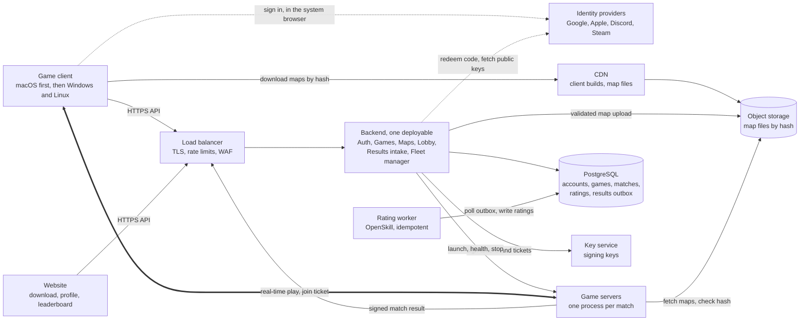
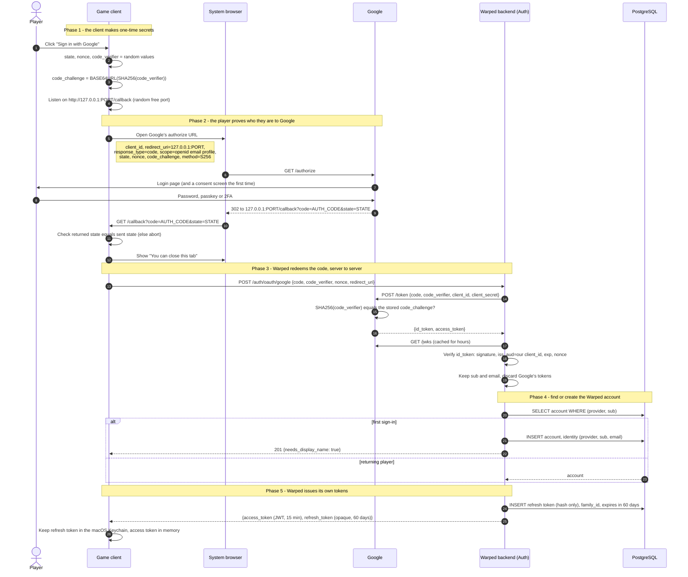
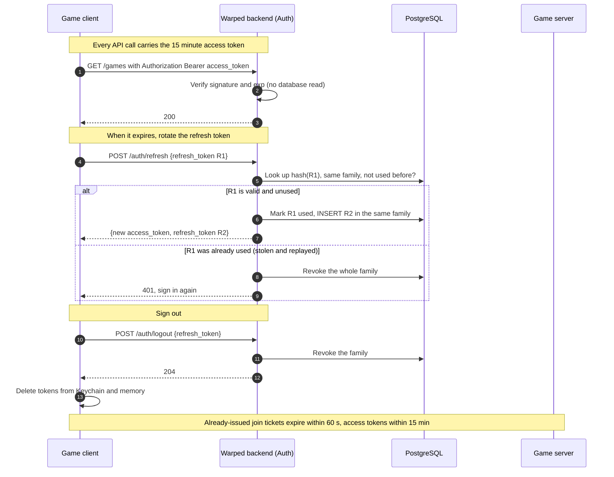
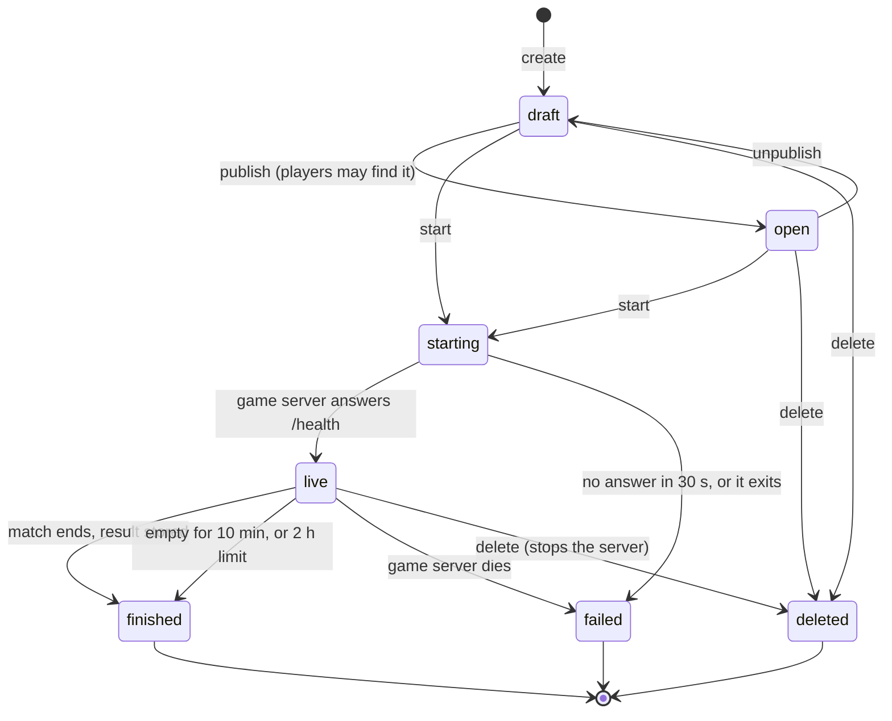
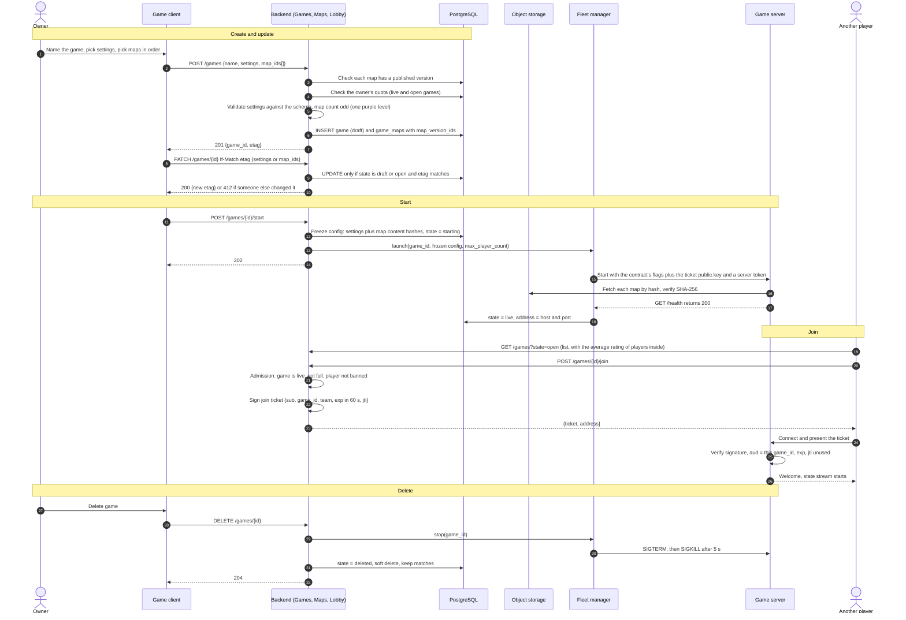
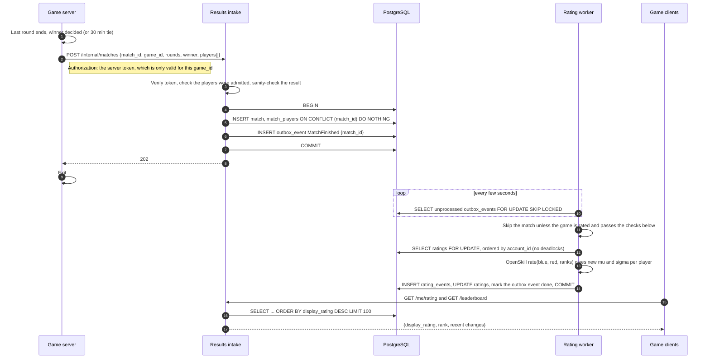
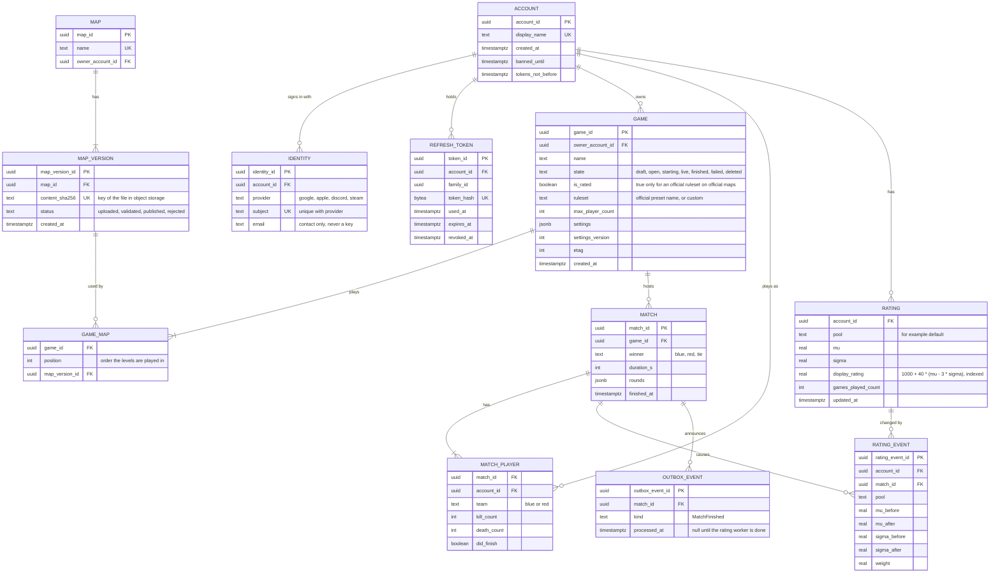

# Cloud architecture proposal

> **Early draft, superseded.** Written on 2026-11-10 before most decisions were made: it has no matchmaking, calls a
> level a "map", limits rated games in a way the user later replaced, and names AWS services nobody has chosen.
> Keep it as raw material for the system design (its diagrams of the whole system, the OAuth sign-in and the data
> model are a starting point), and trust `../OUTSIDE_GAME_DESIGN.md` wherever the two disagree.

A proposal for the official, cloud-hosted version of Warped. It grows the existing management server
(`management_server/`) and game server contract (`common/protocol/game_server_contract.md`) instead of
replacing them. Every diagram is Mermaid, so GitHub renders it.

Status: **draft v2, with open questions at the end.**

## Decisions so far

| Question | Decision |
| --- | --- |
| Who creates games? | Players, only. There is no matchmaking queue: players create, browse and join games. |
| Sign-in | Google at launch. More providers later reuse the same flow. |
| Rating | OpenSkill (team-aware, with an uncertainty value), shown as one number. |
| Size | Hundreds of players, one region. Redis and a message queue are left out until they are needed. |

## What it has to support

| Need | Where it lives |
| --- | --- |
| Create, read, update and delete games, including their settings and which maps they play | [Games module](#3-games-crud-and-joining) |
| Sign up, sign in and sign out, with OAuth | [Auth module](#2-oauth-sign-in-explained) |
| A rating for every player (the "ELO system") | [Rating worker](#4-match-end-and-the-rating-update) |

A **game** here is a room that someone configures (name, settings, an ordered list of maps) and that runs
as one game server process for one match.

## Design principles

- **One modular backend first, not microservices.** The management server grows modules (auth, games,
  maps, lobby, fleet) inside one deployable. Only the rating worker is separate from day one, because it is
  asynchronous by nature. Modules talk through plain function calls and can be split out later.
- **Game servers are cattle.** They hold no durable state. They start from a config, play one match, report
  the result once, and exit. The launcher interface (`launch`, `get`, `list`, `stop`) stays; EC2 or ECS
  becomes one more launcher.
- **Game servers never call the database and rarely call the backend.** A signed join ticket lets a game
  server admit players without a lookup, and one signed result report is the only write it makes.
- **Maps are immutable and content-addressed.** A game points at a map's hash, so editing a map never
  changes a match that is in progress or a past match's meaning.
- **Ratings are a ledger.** Every change is an appended row, so a bad result can be replayed or reversed.
- **Sized for hundreds of players.** One region, one PostgreSQL, no cache and no queue service. The work
  a queue would do (results to the rating worker) is a table in PostgreSQL, and the leaderboard is an
  indexed query. Each of these is a drop-in upgrade later.
- **Players create games, so players can cost money.** Every game runs a server, so each account has a quota
  of live games and every game stops itself when idle.

## 1. The whole system

| Backend module | Job |
| --- | --- |
| Auth | OAuth client for the identity providers, issues and rotates tokens |
| Games | Create, read, update and delete games, their settings and their map list |
| Maps | Accepts, validates, versions and publishes map files |
| Lobby | Game browser, admission rules, quotas, signs join tickets |
| Results intake | Checks a game server's result report and stores the match |
| Fleet manager | The existing launcher: starts, checks and stops game servers |

The two paths to remember:

- **Control path** (slow, secure, transactional): client, load balancer, backend, database.
- **Play path** (fast, authoritative): client to one game server over a real-time connection. The backend is
  not on it. A player's ticket is the only thing connecting the two paths.

## 2. OAuth sign-in, explained

### 2.1 The idea in one paragraph

You never see or store a player's Google password. The player proves who they are *to Google*, and Google
gives Warped a signed statement saying "this is user `1234`, their email is X". Warped treats that statement
as the proof. Everything below is about making sure nobody can steal or forge that statement on its way.

### 2.2 The words

| Term | Meaning here |
| --- | --- |
| Identity provider (IdP) | Google, Apple, Discord or Steam. It owns the password and the login page. |
| Authorization code | A short-lived, one-use ticket the IdP hands back after login. Worthless alone. |
| `id_token` | A signed JSON Web Token from the IdP: who the user is (`sub`), the email, who it was issued for (`aud`), when it expires (`exp`). |
| `sub` | The IdP's permanent ID for that user. Warped keys accounts on `(provider, sub)`, never on email. |
| PKCE | "Proof Key for Code Exchange": the client makes a random `code_verifier`, sends only its hash (`code_challenge`) at the start, and shows the original at the end. Only whoever began the login can finish it. |
| `state` | A random value sent out and checked on return, so a stranger can't push a login into your client. |
| `nonce` | A random value put inside the `id_token`, so an old `id_token` can't be replayed. |
| Loopback redirect | The client briefly listens on `127.0.0.1` so the browser can hand the code back to it. This is the standard for desktop apps (RFC 8252). |

### 2.3 The flow (Authorization Code with PKCE, desktop client)

Only Google is wired up at launch. Another OpenID Connect provider (Apple, Discord with an extra API call) repeats
the same five phases with different URLs. Steam uses OpenID 2.0 and would need its own flow.

What each secret protects against:

| Attack | Stopped by |
| --- | --- |
| Another app on the machine grabs the code from the loopback redirect | PKCE: it lacks `code_verifier`, so Google refuses the code |
| A malicious page tricks the client into finishing someone else's login | `state` |
| A leaked old `id_token` is replayed to log in | `nonce`, `exp` and one-use codes |
| Someone sends Warped a forged `id_token` | Signature check against Google's published keys, plus `aud` and `iss` |
| The client binary is unpacked and the secret read | The client holds no secret: `client_secret` stays on the backend |
| Two accounts merged because an email changed or was reused | Accounts are keyed on `(provider, sub)` |

### 2.4 Staying signed in, signing out

Sign out everywhere is "revoke every family for this account". An account ban also sets a
`not_before` timestamp that the games module checks before issuing any join ticket.

## 3. Games CRUD and joining

A game moves through the states below. Settings and the map list are editable only while it is a draft or
open.

The ticket replaces today's design, where the game server looks the player ID up in the management server on
every connect. That lookup also trusts clients not to steal IDs (`management_server_api.md`). A signed,
short-lived, single-use ticket keeps outsiders out without that trust, and the game server needs no network
call to admit anyone.

Deleting a game never deletes its matches, because ratings refer to them.

## 4. Match end and the rating update

### Why OpenSkill and not plain Elo

Elo is built for one player against one player. A 5 against 5 match forces it to average each team, which
ignores how sure we are about each player. OpenSkill (a Plackett-Luce model, open source and free of
TrueSkill's patent) is built for teams and works like this:

- Each player has two numbers: `mu` (skill estimate) and `sigma` (how unsure we are). New players start at
  `mu = 25`, `sigma = 25 / 3`.
- After a match, the winning team's `mu` rises and the losing team's falls, by more if the result was
  surprising and more for players whose `sigma` is large. `sigma` shrinks with every match.
- A tie is a result where both teams have rank 1. A player who left early can be given a smaller weight
  instead of a full result.
- The number players see is `display_rating = 1000 + 40 * (mu - 3 * sigma)`. A new player shows 1000, and the
  number only climbs once the system is confident, so a lucky streak does not top the leaderboard.

Glicko-2 is the other good choice (it also has an uncertainty value), but it was designed for one on one, so
teams would again be averaged. The ledger stores `mu` and `sigma` before and after, so switching later means
replaying the matches.

### Rules for rating in player-created games

Anyone can create a game, so a rating is easy to farm unless games must earn it:

- A game is **rated** only if its settings equal an official ruleset preset (the owner cannot edit them),
  all its maps are official, and it runs on our fleet. Everything else is unrated.
- A match counts only if each team started with at least a minimum number of players, and the game lasted at
  least a minimum time.
- Repeats against the same opponents count less and less (weight by how many of the last 20 matches the same
  group played together), so two friends cannot trade wins.
- Players cannot rate in a game they own with an account that has fewer than a minimum number of matches
  from other owners' games.
- Each `rating_events` row stores `mu_before`, `mu_after`, `sigma_before`, `sigma_after`, `weight` and
  `match_id`, so a corrected or voided result can be replayed from the ledger.

## 5. Data model

## 6. Where AWS fits (one possible mapping, sized for hundreds of players)

| Box in diagram 1 | AWS service | Why |
| --- | --- | --- |
| CDN, load balancer | CloudFront, ALB with WAF | managed TLS and rate limits |
| Backend and rating worker | ECS Fargate, 2 tasks and 1 task | stateless, no servers to patch |
| PostgreSQL | RDS PostgreSQL, Multi-AZ | one place for transactions, also the outbox |
| Object storage | S3 | content-addressed maps |
| Key service | KMS (asymmetric keys) | signing keys never leave it |
| Game servers | EC2 per game, started by the `Launcher` | simple, and the launcher interface hides the choice |
| Sign-in | Own Auth module, or Cognito if we would rather not run it | see the open questions |

Upgrades when they are needed: a pre-warmed server pool when starting a game feels slow, Redis when the
leaderboard or game list is queried too often, SQS when more than one consumer needs match results,
read replicas when PostgreSQL is busy.

## 7. How this maps onto what exists

| Today | In this proposal |
| --- | --- |
| `POST /game-servers` | `POST /games` creates, `POST /games/{id}/start` launches |
| `GameServerConfig = {}` | `settings` (versioned) plus the ordered map list |
| Player ID looked up on every connect | A signed join ticket verified offline |
| `Launcher` (local process) | Unchanged, plus an EC2 or ECS launcher |
| `common/maps/` folders | Published as map versions: `validate_map.py` runs at upload, the folder's hash is the key |
| No accounts | Accounts, identities, refresh tokens |

## Open questions

1. **Rated games:** is "rated only on an official ruleset and official maps" the right rule for player-created
   games? Or should custom games rate too, with a separate leaderboard?
2. **Quotas:** how many games may one account have live at once, and how long may one run idle? The draft says
   one, 10 minutes idle and a 2 hour limit.
3. **Who may publish maps:** only us, or players too? Player uploads need size limits, a stricter validator and
   a review step.
4. **Round depth:** should how far the wavefront went change the rating change, or only win, loss and tie?
5. **Leavers and bans:** what is the penalty for leaving a rated match early, and who can ban an account?
6. **Hosting:** is there a monthly budget that should cap the fleet?
