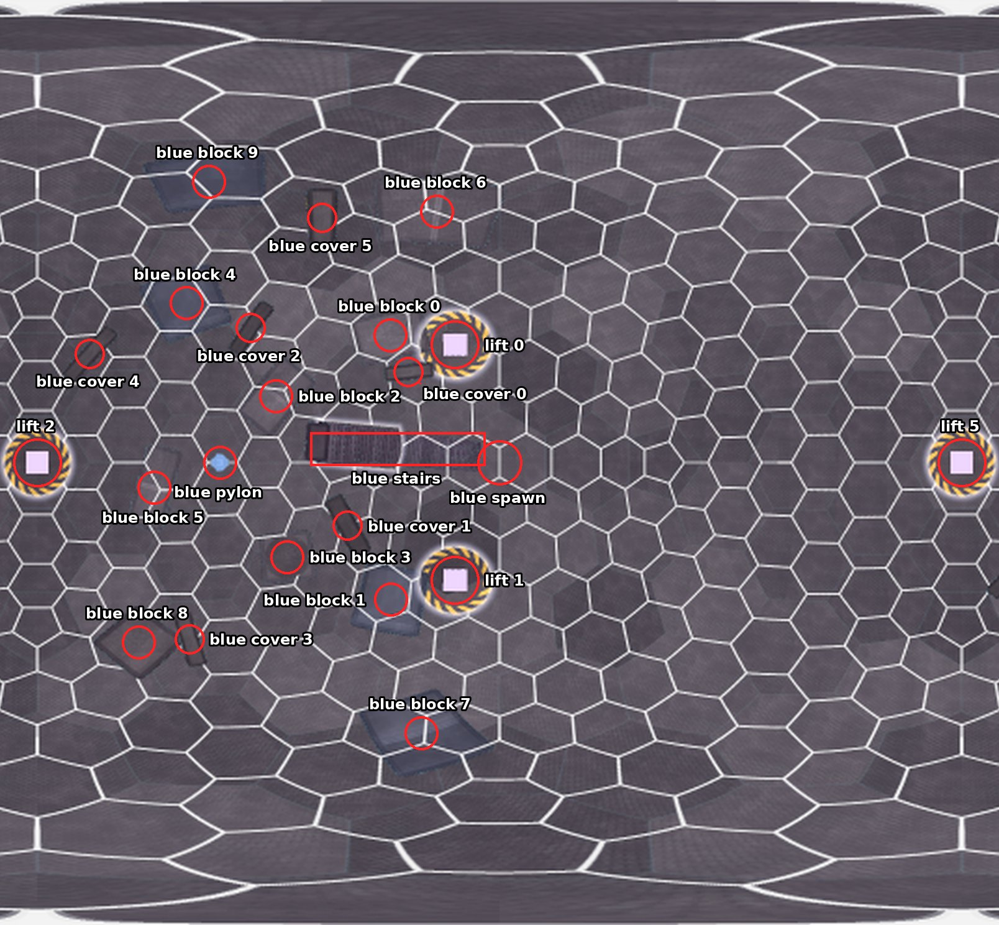
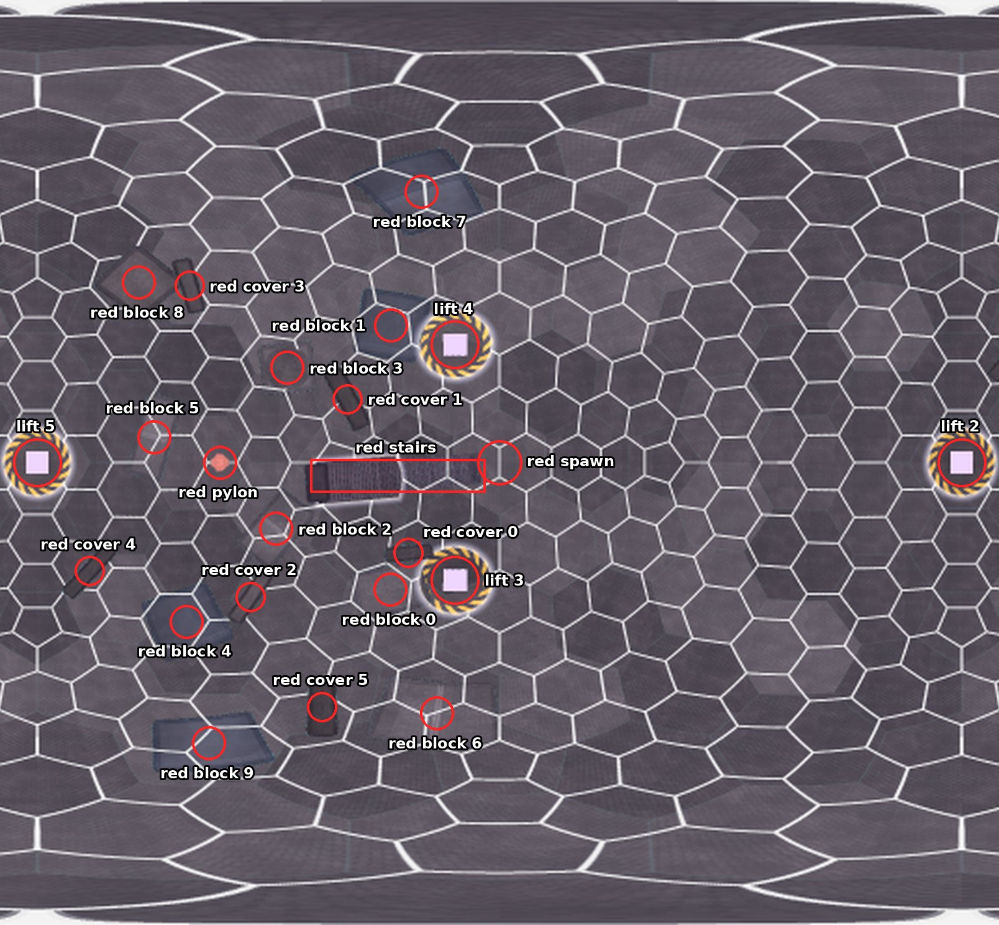

# City Sphere

City Sphere is the purple level in the middle of the map (depth 0): a satellite city inside a hollow sphere in flat
space, 24 m in radius, where gravity pulls outward onto the inside of the sphere. Its streets cover the sphere's
surface, a glass shell 17 m in radius roofs them and is the glass level, six lifts lead up to the glass level, and a
glowing core hangs in the centre. Players see each other through the glass but can't shoot through it. It is the
smallest level and is built for close quarters, with no warp objects and one pylon per team, on the glass level. Red's
spawn and pylon are blue's reflected through the sphere's centre.

The level layout ([`common/maps/city_sphere/map.json`](../../common/maps/city_sphere/map.json)) splits the sphere into
two zones, the blue half and the red half, with no middle zone. Names follow the
[naming rules](README.md#naming-rules).

> NOTE: In the game, City Sphere's team areas are domes over the two pylons on the glass level, and everything else
> is the middle ([`DESIGN.md`](../DESIGN.md#zones-and-routes)). The zones here are the level layout's two halves,
> which the game doesn't use yet.

The pictures mark the game's map picture of City Sphere (`demos/city_sphere_rust/assets/map_picture.png`), an
unwrapped view of the whole sphere like a world map: longitude across, latitude up and down. The blue picture is
centred on blue's spawn and the red picture on red's, so each shows its own half in the middle and the other half cut
in two at its sides.

## World tree

```text
City Sphere
├── blue zone
│   ├── blue spawn, blue stairs
│   ├── blue pylon
│   ├── blue block 0 to 9
│   ├── blue cover 0 to 5
│   └── lift 0, lift 1
├── red zone
│   ├── red spawn, red stairs
│   ├── red pylon
│   ├── red block 0 to 9
│   ├── red cover 0 to 5
│   └── lift 3, lift 4
└── on the line between the zones
    └── lift 2, lift 5
```

## Blue zone



| Name | What it is | Name in the level layout |
| --- | --- | --- |
| **blue spawn** | Where blue's players enter the level, on the streets. | blue spawn (two spawn points) |
| **blue stairs** | The staircase of 48 steps that rises from the streets beside blue's spawn. | blue stairs 0 to 47 |
| **blue pylon** | Blue's one pylon, on the glass level in an exposed spot with no cover around it. | blue pylon, blue console |
| **blue block 0** to **9** | The city blocks on the streets of blue's half, numbered as in the level layout. | blue block 0 to 9 |
| **blue cover 0** to **5** | The cover on the glass level in blue's half, numbered as in the level layout. | blue glass cover 0 to 5 |
| **lift 0**, **lift 1** | The two lifts in blue's half, from the streets up to the glass level. | lift pad 0, lift pad 1 |

## Red zone



| Name | What it is | Name in the level layout |
| --- | --- | --- |
| **red spawn** | Where red's players enter the level, on the streets. | red spawn (two spawn points) |
| **red stairs** | The staircase of 48 steps that rises from the streets beside red's spawn. | red stairs 0 to 47 |
| **red pylon** | Red's one pylon, on the glass level in an exposed spot with no cover around it. | red pylon, red console |
| **red block 0** to **9** | The city blocks on the streets of red's half, numbered as in the level layout. | red block 0 to 9 |
| **red cover 0** to **5** | The cover on the glass level in red's half, numbered as in the level layout. | red glass cover 0 to 5 |
| **lift 3**, **lift 4** | The two lifts in red's half, from the streets up to the glass level. | lift pad 3, lift pad 4 |

## On the line between the zones

| Name | What it is | Name in the level layout |
| --- | --- | --- |
| **lift 2**, **lift 5** | The two lifts that stand exactly on the line between the halves, at the left and right edges of both pictures. | lift pad 2, lift pad 5 |

City Sphere's blocks and covers keep the level layout's numbers rather than being numbered from the spawn outward,
and its lifts have no team in their names, as in the level layout.
