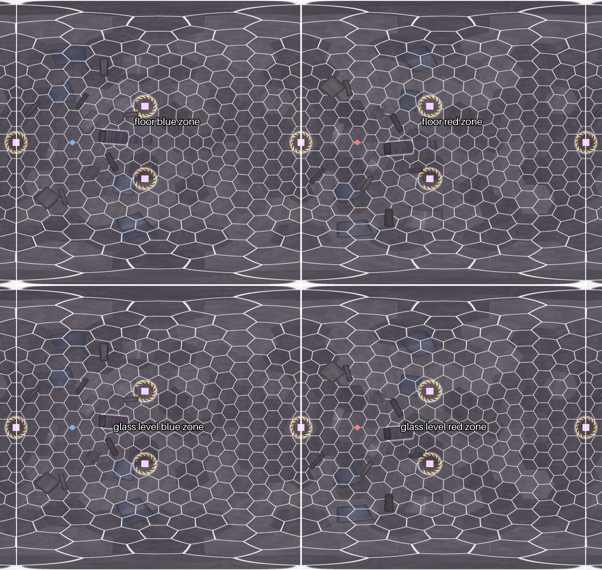
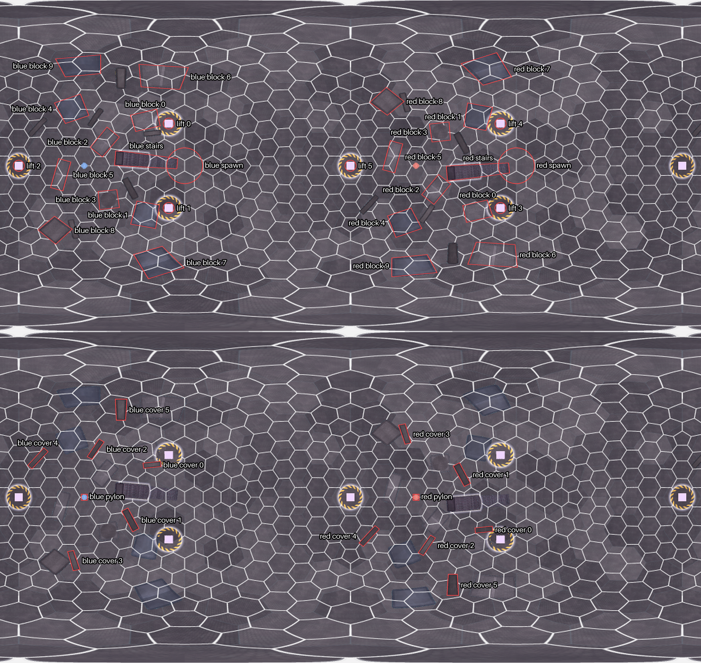
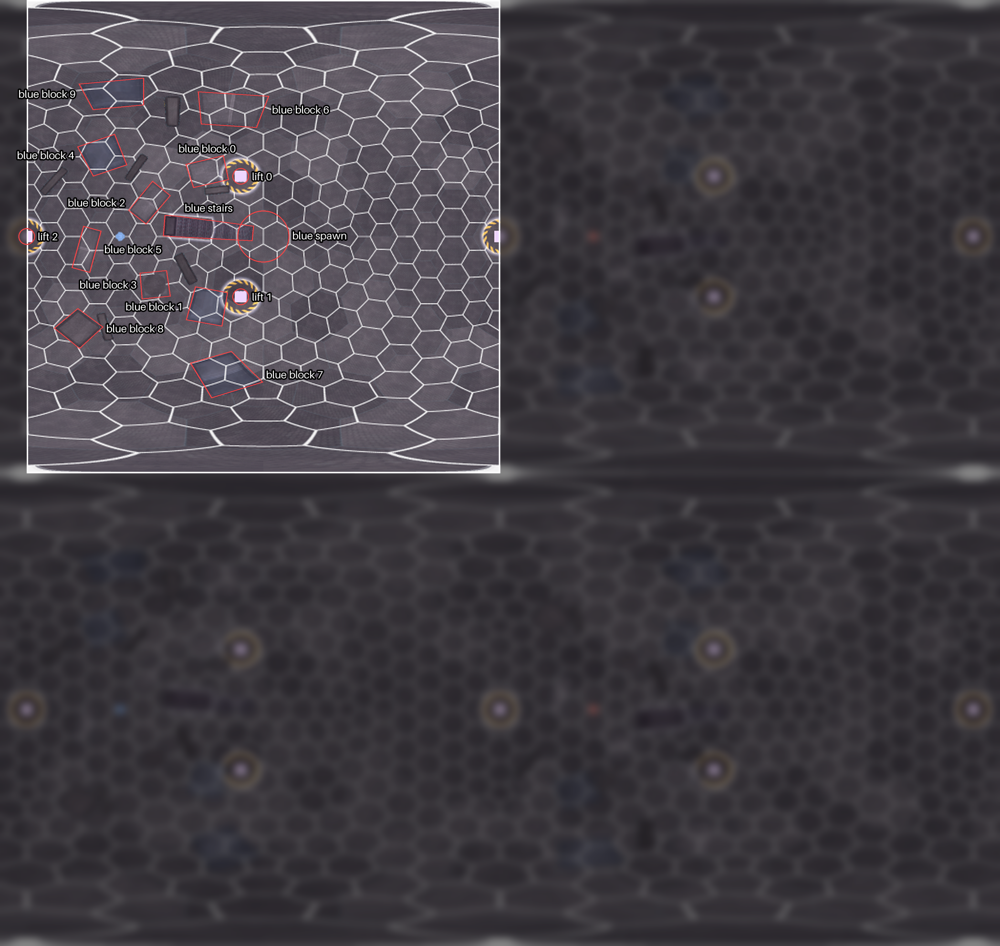
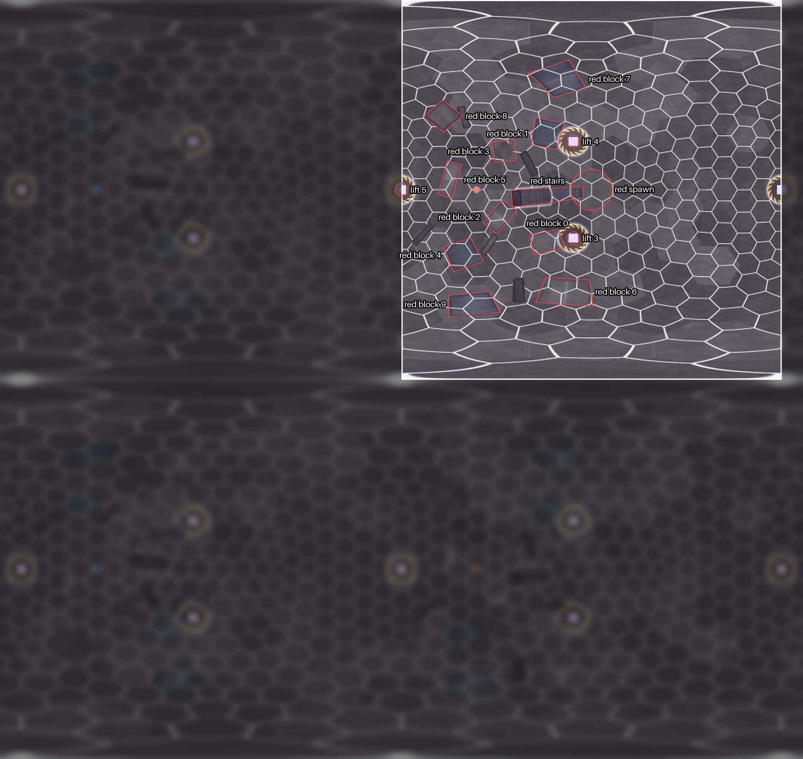
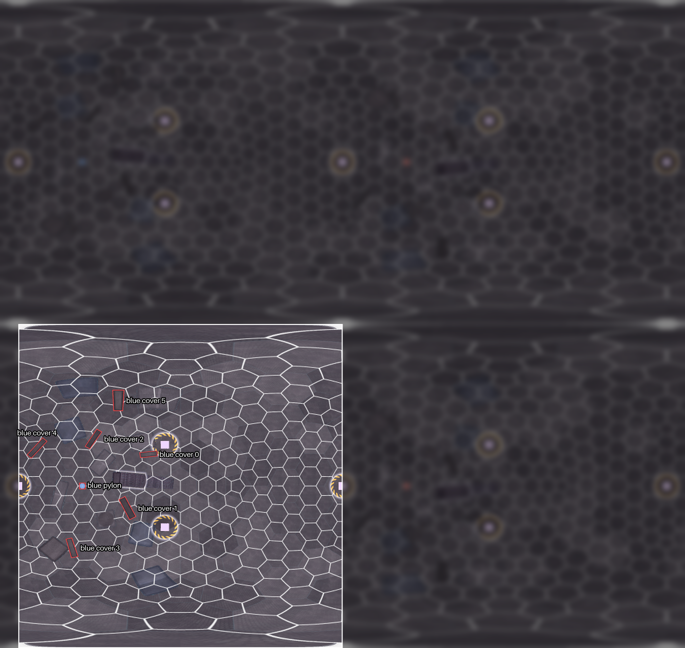
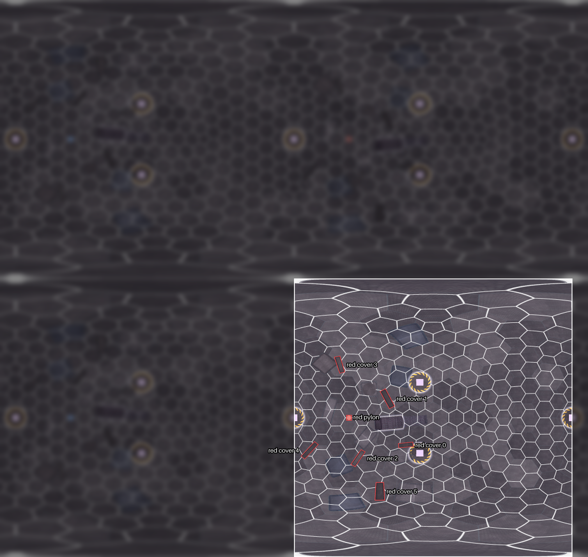

<!-- game_design/worlds/make_world_doc.py writes this file from ../source/. Edit those files, not this one. -->

# City Sphere

City Sphere is the purple level in the middle of the map (depth 0): a satellite city inside a hollow sphere in flat
space, 24 m in radius, where gravity pulls outward onto the inside of the sphere. Its city blocks stand on the floor,
the sphere's surface; a glass shell 17 m in radius roofs the floor, and its inner side is the glass level. Stairs and
six lifts lead up to the glass level, and a glowing core hangs in the centre. Players see each other through the glass but can't shoot through it. It is the
smallest level and is built for close quarters, with no warp objects and one pylon per team, on the glass level. Red's
spawn and pylon are blue's reflected through the sphere's centre.

The level layout ([`common/maps/city_sphere/map.json`](../../../../common/maps/city_sphere/map.json)) splits the
sphere into two zones, the blue half and the red half, with no middle zone. This doc splits each half again into the
floor (24 m from the centre) and the glass level (17 m from the centre), so it has four zones: the floor blue zone, the
floor red zone, the glass level blue zone and the glass level red zone. Names follow the [naming rules](../../README.md#naming-rules).

> NOTE: In the game, City Sphere's team areas are domes over the two pylons on the glass level, and everything else
> is the middle ([`DESIGN.md`](../../../DESIGN.md#zones-and-routes)). The zones here are the level layout's two halves,
> which the game doesn't use yet.

The pictures are the game's map picture of City Sphere (`demos/city_sphere_rust/assets/map_picture.png`), an unwrapped
view of the whole sphere like a world map: longitude across, latitude up and down. It is scaled up twice and shifted so
that each half is in one piece, blue's on the left and red's on the right, with a strip repeated at each side. The
picture appears twice, one copy above the other: objects on the floor are marked on the top copy, and objects on the
glass level on the bottom copy.



## World tree

```text
City Sphere
├── floor blue zone
│   ├── blue spawn
│   ├── blue stairs
│   ├── blue block 0
│   ├── blue block 1
│   ├── blue block 2
│   ├── blue block 3
│   ├── blue block 4
│   ├── blue block 5
│   ├── blue block 6
│   ├── blue block 7
│   ├── blue block 8
│   ├── blue block 9
│   ├── lift 0
│   ├── lift 1
│   └── lift 2
├── floor red zone
│   ├── red spawn
│   ├── red stairs
│   ├── red block 0
│   ├── red block 1
│   ├── red block 2
│   ├── red block 3
│   ├── red block 4
│   ├── red block 5
│   ├── red block 6
│   ├── red block 7
│   ├── red block 8
│   ├── red block 9
│   ├── lift 3
│   ├── lift 4
│   └── lift 5
├── glass level blue zone
│   ├── blue pylon
│   ├── blue cover 0
│   ├── blue cover 1
│   ├── blue cover 2
│   ├── blue cover 3
│   ├── blue cover 4
│   └── blue cover 5
└── glass level red zone
    ├── red pylon
    ├── red cover 0
    ├── red cover 1
    ├── red cover 2
    ├── red cover 3
    ├── red cover 4
    └── red cover 5
```



## Floor blue zone

The floor, 24 m from the centre, in the level layout's blue half.



| Name | What it is | Name in the level layout |
| --- | --- | --- |
| **blue spawn** | Where blue's players enter the level, on the floor: two spawn points. | blue spawn |
| **blue stairs** | The staircase of 48 steps that rises from the floor beside blue's spawn. | blue stairs 0 to 47 |
| **blue block 0** | A city block on the floor of blue's half, numbered as in the level layout. | blue block 0 |
| **blue block 1** | A city block on the floor of blue's half, numbered as in the level layout. | blue block 1 |
| **blue block 2** | A city block on the floor of blue's half, numbered as in the level layout. | blue block 2 |
| **blue block 3** | A city block on the floor of blue's half, numbered as in the level layout. | blue block 3 |
| **blue block 4** | A city block on the floor of blue's half, numbered as in the level layout. | blue block 4 |
| **blue block 5** | A city block on the floor of blue's half, numbered as in the level layout. | blue block 5 |
| **blue block 6** | A city block on the floor of blue's half, numbered as in the level layout. | blue block 6 |
| **blue block 7** | A city block on the floor of blue's half, numbered as in the level layout. | blue block 7 |
| **blue block 8** | A city block on the floor of blue's half, numbered as in the level layout. | blue block 8 |
| **blue block 9** | A city block on the floor of blue's half, numbered as in the level layout. | blue block 9 |
| **lift 0** | A lift in blue's half, from the floor up to the glass level. | lift pad 0 |
| **lift 1** | A lift in blue's half, from the floor up to the glass level. | lift pad 1 |
| **lift 2** | A lift from the floor up to the glass level, exactly on the line between the halves; it is listed in blue's half. | lift pad 2 |

## Floor red zone

The floor, 24 m from the centre, in the level layout's red half.



| Name | What it is | Name in the level layout |
| --- | --- | --- |
| **red spawn** | Where red's players enter the level, on the floor: two spawn points. | red spawn |
| **red stairs** | The staircase of 48 steps that rises from the floor beside red's spawn. | red stairs 0 to 47 |
| **red block 0** | A city block on the floor of red's half, numbered as in the level layout. | red block 0 |
| **red block 1** | A city block on the floor of red's half, numbered as in the level layout. | red block 1 |
| **red block 2** | A city block on the floor of red's half, numbered as in the level layout. | red block 2 |
| **red block 3** | A city block on the floor of red's half, numbered as in the level layout. | red block 3 |
| **red block 4** | A city block on the floor of red's half, numbered as in the level layout. | red block 4 |
| **red block 5** | A city block on the floor of red's half, numbered as in the level layout. | red block 5 |
| **red block 6** | A city block on the floor of red's half, numbered as in the level layout. | red block 6 |
| **red block 7** | A city block on the floor of red's half, numbered as in the level layout. | red block 7 |
| **red block 8** | A city block on the floor of red's half, numbered as in the level layout. | red block 8 |
| **red block 9** | A city block on the floor of red's half, numbered as in the level layout. | red block 9 |
| **lift 3** | A lift in red's half, from the floor up to the glass level. | lift pad 3 |
| **lift 4** | A lift in red's half, from the floor up to the glass level. | lift pad 4 |
| **lift 5** | A lift from the floor up to the glass level, exactly on the line between the halves; it is listed in red's half. | lift pad 5 |

## Glass level blue zone

The glass level, 17 m from the centre, in the level layout's blue half.



| Name | What it is | Name in the level layout |
| --- | --- | --- |
| **blue pylon** | Blue's one pylon, on the glass level in an exposed spot with no cover around it. | blue pylon, blue console |
| **blue cover 0** | Cover on the glass level in blue's half, numbered as in the level layout. | blue glass cover 0 |
| **blue cover 1** | Cover on the glass level in blue's half, numbered as in the level layout. | blue glass cover 1 |
| **blue cover 2** | Cover on the glass level in blue's half, numbered as in the level layout. | blue glass cover 2 |
| **blue cover 3** | Cover on the glass level in blue's half, numbered as in the level layout. | blue glass cover 3 |
| **blue cover 4** | Cover on the glass level in blue's half, numbered as in the level layout. | blue glass cover 4 |
| **blue cover 5** | Cover on the glass level in blue's half, numbered as in the level layout. | blue glass cover 5 |

## Glass level red zone

The glass level, 17 m from the centre, in the level layout's red half.



| Name | What it is | Name in the level layout |
| --- | --- | --- |
| **red pylon** | Red's one pylon, on the glass level in an exposed spot with no cover around it. | red pylon, red console |
| **red cover 0** | Cover on the glass level in red's half, numbered as in the level layout. | red glass cover 0 |
| **red cover 1** | Cover on the glass level in red's half, numbered as in the level layout. | red glass cover 1 |
| **red cover 2** | Cover on the glass level in red's half, numbered as in the level layout. | red glass cover 2 |
| **red cover 3** | Cover on the glass level in red's half, numbered as in the level layout. | red glass cover 3 |
| **red cover 4** | Cover on the glass level in red's half, numbered as in the level layout. | red glass cover 4 |
| **red cover 5** | Cover on the glass level in red's half, numbered as in the level layout. | red glass cover 5 |

City Sphere's blocks and covers keep the level layout's numbers rather than being numbered from the spawn outward, and
its lifts have no team in their names, as in the level layout. Lifts 2 and 5 stand exactly on the line between the
halves; lift 2 is listed in the floor blue zone and lift 5 in the floor red zone. Each lift is listed on the floor,
where its pad is, though it also reaches the glass level.
