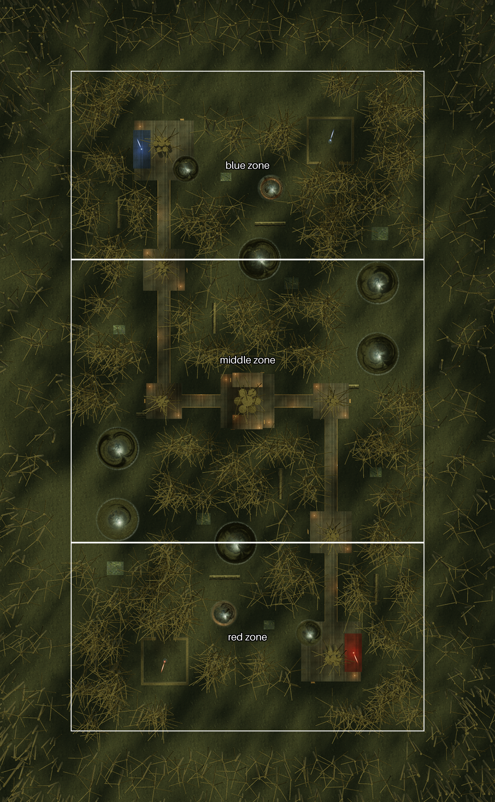
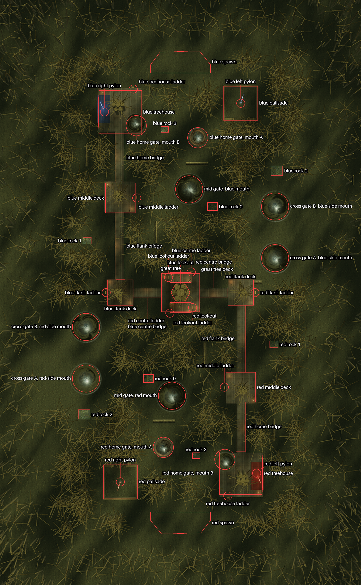
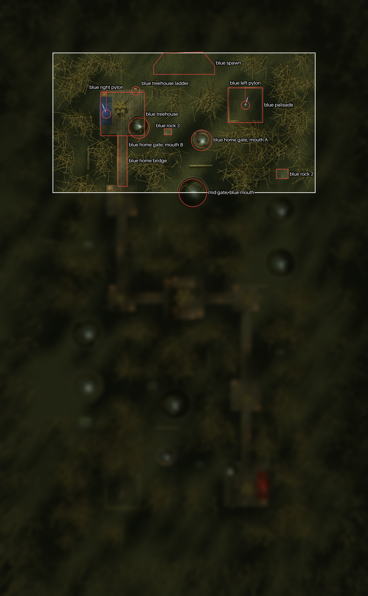
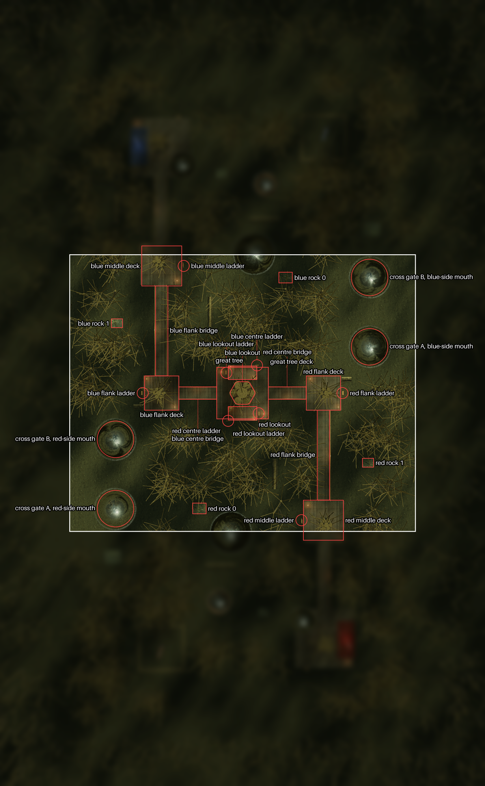
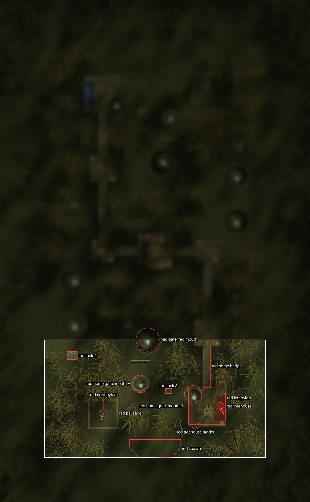

<!-- game_design/worlds/make_world_doc.py writes this file from ../source/. Edit those files, not this one. -->

# Dark Forest

Dark Forest is the inner red level (depth 1): a dark forest in flat space whose soft level edge slows players without
end. Each team has two pylons: one in a palisade and one in a treehouse. Rope ladders lead up to decks in the trees,
bridges join the decks into a high route across the middle, and the great tree in the centre carries a deck with two
lookouts. Five fixed wormholes, called gates here, join places across the level. The zones are bands across the
level's length: the blue zone is more than 24 m from the middle on blue's side, the red zone more than 24 m on red's
side, and the middle zone lies between.

The pictures are the game's map picture of Dark Forest (`demos/dark_forest_rust/assets/map_picture.png`), scaled up
twice, with blue at the top. Blue faces down the picture, so left (blue's left) is the right of a picture. Names follow
the [naming rules](../../README.md#naming-rules), with the exceptions at the end of this file; the layout is
[`common/maps/dark_forest/map.json`](../../../../common/maps/dark_forest/map.json).



## World tree

```text
Dark Forest
├── blue zone
│   ├── blue spawn
│   ├── blue palisade
│   ├── blue left pylon
│   ├── blue treehouse
│   ├── blue right pylon
│   ├── blue treehouse ladder
│   ├── blue home bridge
│   ├── blue home gate, mouth A
│   ├── blue home gate, mouth B
│   ├── mid gate, blue mouth
│   ├── blue rock 2
│   └── blue rock 3
├── middle zone
│   ├── great tree
│   ├── great tree deck
│   ├── blue lookout
│   ├── red lookout
│   ├── blue lookout ladder
│   ├── red lookout ladder
│   ├── blue centre ladder
│   ├── red centre ladder
│   ├── blue middle deck
│   ├── red middle deck
│   ├── blue middle ladder
│   ├── red middle ladder
│   ├── blue flank bridge
│   ├── red flank bridge
│   ├── blue flank deck
│   ├── red flank deck
│   ├── blue flank ladder
│   ├── red flank ladder
│   ├── blue centre bridge
│   ├── red centre bridge
│   ├── cross gate A, blue-side mouth
│   ├── cross gate A, red-side mouth
│   ├── cross gate B, blue-side mouth
│   ├── cross gate B, red-side mouth
│   ├── blue rock 0
│   ├── blue rock 1
│   ├── red rock 0
│   └── red rock 1
└── red zone
    ├── red spawn
    ├── red palisade
    ├── red right pylon
    ├── red treehouse
    ├── red left pylon
    ├── red treehouse ladder
    ├── red home bridge
    ├── red home gate, mouth A
    ├── red home gate, mouth B
    ├── mid gate, red mouth
    ├── red rock 2
    └── red rock 3
```



## Blue zone

Blue's end of the level: everything more than 24 m from the middle on blue's side.



| Name | What it is | Name in the level layout |
| --- | --- | --- |
| **blue spawn** | Where blue's players enter the level: six spawn points. | blue spawn |
| **blue palisade** | The square fence around blue's left pylon. | blue palisade |
| **blue left pylon** | Blue's pylon inside the palisade, on blue's left. | blue pylon 0 |
| **blue treehouse** | The treehouse on blue's right, which holds blue's right pylon. | blue treehouse |
| **blue right pylon** | Blue's pylon in the treehouse. | blue pylon 1 |
| **blue treehouse ladder** | The rope ladder up to the treehouse. | blue treehouse ladder |
| **blue home bridge** | The bridge from the treehouse toward the middle, to the blue middle deck. | blue home bridge |
| **blue home gate, mouth A** | One of the two mouths of the wormhole inside the blue zone; it leads to mouth B. | gate 4 mouth 0 |
| **blue home gate, mouth B** | One of the two mouths of the wormhole inside the blue zone; it leads to mouth A. | gate 4 mouth 1 |
| **mid gate, blue mouth** | The blue end of the wormhole that joins the two team zones, on the blue zone's edge. | gate 2 mouth 1 |
| **blue rock 2** | One of the two rocks of the blue zone. | blue rock 2 |
| **blue rock 3** | One of the two rocks of the blue zone. | blue rock 3 |

## Middle zone

The 48 m band across the middle of the level, between the team zones.



| Name | What it is | Name in the level layout |
| --- | --- | --- |
| **great tree** | The great tree in the centre of the level. | the great tree |
| **great tree deck** | The deck in the great tree, where the high route crosses the centre. | the great tree deck |
| **blue lookout** | The lookout 5 m above the great tree deck, on blue's side. | blue lookout |
| **red lookout** | The lookout 5 m above the great tree deck, on red's side. | red lookout |
| **blue lookout ladder** | The rope ladder from the great tree deck up to the blue lookout. | blue lookout ladder |
| **red lookout ladder** | The rope ladder from the great tree deck up to the red lookout. | red lookout ladder |
| **blue centre ladder** | The rope ladder from the ground up to the great tree deck, on blue's side. | blue centre ladder |
| **red centre ladder** | The rope ladder from the ground up to the great tree deck, on red's side. | red centre ladder |
| **blue middle deck** | The deck at blue's end of the high route, where the blue home bridge arrives. | blue middle deck |
| **red middle deck** | The deck at red's end of the high route, where the red home bridge arrives. | red middle deck |
| **blue middle ladder** | The rope ladder up to the blue middle deck. | blue middle ladder |
| **red middle ladder** | The rope ladder up to the red middle deck. | red middle ladder |
| **blue flank bridge** | The bridge from the blue middle deck to the blue flank deck. | blue flank bridge |
| **red flank bridge** | The bridge from the red middle deck to the red flank deck. | red flank bridge |
| **blue flank deck** | The deck halfway along at blue's side of the centre. | blue flank deck |
| **red flank deck** | The deck halfway along at red's side of the centre. | red flank deck |
| **blue flank ladder** | The rope ladder up to the blue flank deck. | blue flank ladder |
| **red flank ladder** | The rope ladder up to the red flank deck. | red flank ladder |
| **blue centre bridge** | The bridge from the blue flank deck to the great tree deck. | blue centre bridge |
| **red centre bridge** | The bridge from the red flank deck to the great tree deck. | red centre bridge |
| **cross gate A, blue-side mouth** | The blue-side mouth of a wormhole that crosses the middle zone; it leads to cross gate A's red-side mouth. | gate 0 mouth 1 |
| **cross gate A, red-side mouth** | The red-side mouth of a wormhole that crosses the middle zone; it leads to cross gate A's blue-side mouth. | gate 0 mouth 0 |
| **cross gate B, blue-side mouth** | The blue-side mouth of the other wormhole that crosses the middle zone; it leads to cross gate B's red-side mouth. | gate 1 mouth 0 |
| **cross gate B, red-side mouth** | The red-side mouth of the other wormhole that crosses the middle zone; it leads to cross gate B's blue-side mouth. | gate 1 mouth 1 |
| **blue rock 0** | One of the two rocks of the middle zone on blue's side. | blue rock 0 |
| **blue rock 1** | One of the two rocks of the middle zone on blue's side. | blue rock 1 |
| **red rock 0** | One of the two rocks of the middle zone on red's side. | red rock 0 |
| **red rock 1** | One of the two rocks of the middle zone on red's side. | red rock 1 |

## Red zone

Red's end of the level: everything more than 24 m from the middle on red's side.



| Name | What it is | Name in the level layout |
| --- | --- | --- |
| **red spawn** | Where red's players enter the level: six spawn points. | red spawn |
| **red palisade** | The square fence around the red right pylon. | red palisade |
| **red right pylon** | Red's pylon inside the palisade, on blue's right. | red pylon 0 |
| **red treehouse** | The treehouse on blue's left, which holds the red left pylon. | red treehouse |
| **red left pylon** | Red's pylon in the treehouse. | red pylon 1 |
| **red treehouse ladder** | The rope ladder up to the treehouse. | red treehouse ladder |
| **red home bridge** | The bridge from the treehouse toward the middle, to the red middle deck. | red home bridge |
| **red home gate, mouth A** | One of the two mouths of the wormhole inside the red zone; it leads to mouth B. | gate 3 mouth 0 |
| **red home gate, mouth B** | One of the two mouths of the wormhole inside the red zone; it leads to mouth A. | gate 3 mouth 1 |
| **mid gate, red mouth** | The red end of the wormhole that joins the two team zones, on the red zone's edge. | gate 2 mouth 0 |
| **red rock 2** | One of the two rocks of the red zone. | red rock 2 |
| **red rock 3** | One of the two rocks of the red zone. | red rock 3 |

## Exceptions to the naming rules

These names were approved as they are, from the level layout, though they break two rules:

- **Team names in the middle zone.** The decks, bridges, lookouts and ladders of the high route, and the middle zone's
  rocks, carry the name of the team whose side they are on ("blue middle deck"), not "blue-side".
- **Rock numbers.** Each team's rocks are numbered 0 to 3 roughly from the centre toward its spawn: rocks 0 and 1 are
  in the middle zone, and rock 3 is the nearest to the spawn, not the farthest.

The forest's other trees aren't named here. Each treehouse and deck stands in a tree of its own in the level layout
(such as "blue home tree", "blue middle tree" and "blue flank tree").
