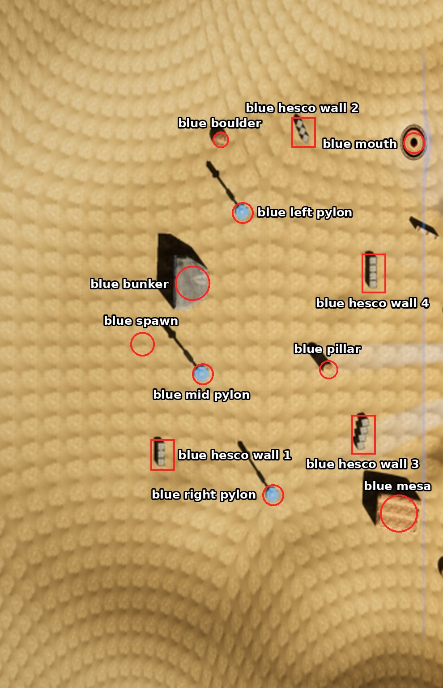
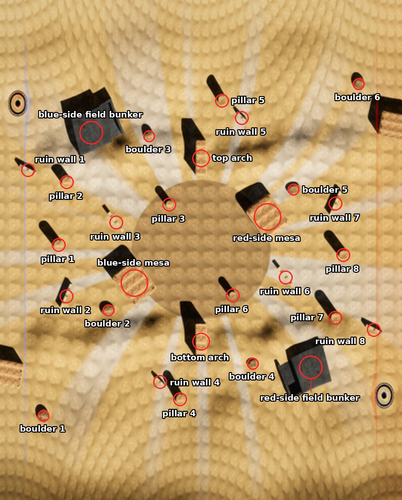
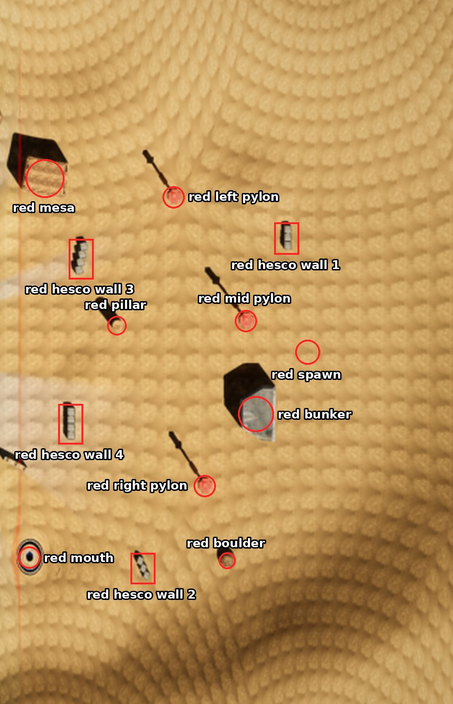

# Dust

Dust is the outer blue level (depth 2): a desert basin in hyperbolic space (curvature radius 50 m) under a constant
sandstorm whose wind bends light, and so lasers. Each team has three pylons. One fixed wormhole joins the blue zone to
the red zone, and there is no black hole. The zones are bands across the level's length: the blue zone is more than
48 m from the middle on blue's side, the red zone more than 48 m on red's side, and the middle zone lies between.

The pictures mark the game's map picture of Dust (`demos/dust_rust/map_pictures/dust_r50m.png`), with blue on the
left, so left (blue's left) is the top of a picture. Names follow the [naming rules](README.md#naming-rules);
the layout is [`common/maps/dust/map.json`](../../common/maps/dust/map.json).

## World tree

```text
Dust
├── blue zone
│   ├── blue spawn, blue bunker
│   ├── blue left pylon, blue mid pylon, blue right pylon
│   ├── blue hesco wall 1, 2, 3, 4
│   ├── blue boulder, blue pillar, blue mesa
│   └── blue mouth
├── middle zone
│   ├── blue-side field bunker, red-side field bunker
│   ├── blue-side mesa, red-side mesa
│   ├── top arch, bottom arch
│   ├── ruin wall 1 to 8
│   ├── pillar 1 to 8
│   └── boulder 1 to 6
└── red zone
    ├── red spawn, red bunker
    ├── red left pylon, red mid pylon, red right pylon
    ├── red hesco wall 1, 2, 3, 4
    ├── red boulder, red pillar, red mesa
    └── red mouth
```

## Blue zone



| Name | What it is | Name in the level layout |
| --- | --- | --- |
| **blue spawn** | Where blue's players enter the level. | blue spawn |
| **blue bunker** | The concrete bunker beside blue's spawn. | blue kazemat |
| **blue left pylon**, **blue mid pylon**, **blue right pylon** | Blue's three pylons, left to right as seen from blue's spawn facing red. | blue pylon |
| **blue hesco wall 1** to **4** | Rows of 3 or 4 Hesco blocks, numbered from blue's spawn outward. | hesco block |
| **blue boulder** | The boulder at the top of the blue zone. | boulder |
| **blue pillar** | The sandstone pillar in front of blue's pylons. | sandstone pillar |
| **blue mesa** | The sandstone mesa at the bottom edge of the blue zone. | sandstone mesa |
| **blue mouth** | The blue zone's mouth of the wormhole that leads to the red mouth. | wormhole mouth A |

## Middle zone



| Name | What it is | Name in the level layout |
| --- | --- | --- |
| **blue-side field bunker**, **red-side field bunker** | The two field bunkers, one on each team's side of the middle. | blue field bunker, red field bunker |
| **blue-side mesa**, **red-side mesa** | The two sandstone mesas on either side of the centre. | sandstone mesa |
| **top arch**, **bottom arch** | The two sandstone arches halfway along, at the top and bottom of the main map. | sandstone arch |
| **ruin wall 1** to **8** | Broken walls, numbered from blue's side to red's. | ruin wall |
| **pillar 1** to **8** | Sandstone pillars, numbered from blue's side to red's. | sandstone pillar |
| **boulder 1** to **6** | Boulders, numbered from blue's side to red's. | boulder |

## Red zone



| Name | What it is | Name in the level layout |
| --- | --- | --- |
| **red spawn** | Where red's players enter the level. | red spawn |
| **red bunker** | The concrete bunker beside red's spawn. | red kazemat |
| **red left pylon**, **red mid pylon**, **red right pylon** | Red's three pylons, left to right as seen from blue's spawn facing red. | red pylon |
| **red hesco wall 1** to **4** | Rows of 3 or 4 Hesco blocks, numbered from red's spawn outward. | hesco block |
| **red boulder** | The boulder at the bottom of the red zone. | boulder |
| **red pillar** | The sandstone pillar in front of red's pylons. | sandstone pillar |
| **red mesa** | The sandstone mesa at the top edge of the red zone. | sandstone mesa |
| **red mouth** | The red zone's mouth of the wormhole that leads to the blue mouth. | wormhole mouth B |
