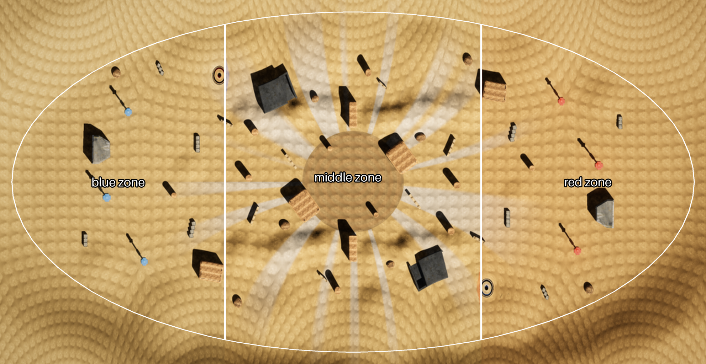
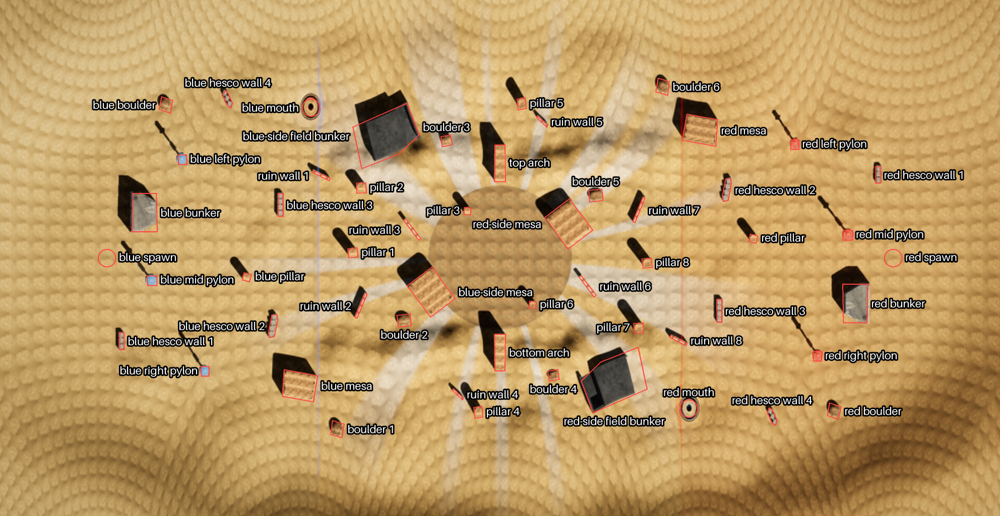
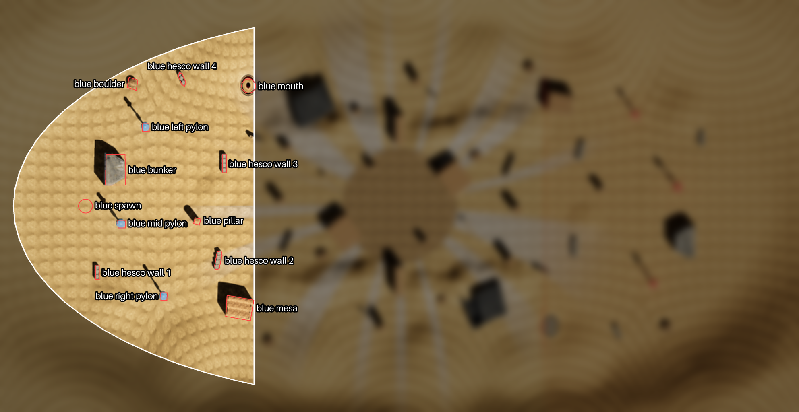
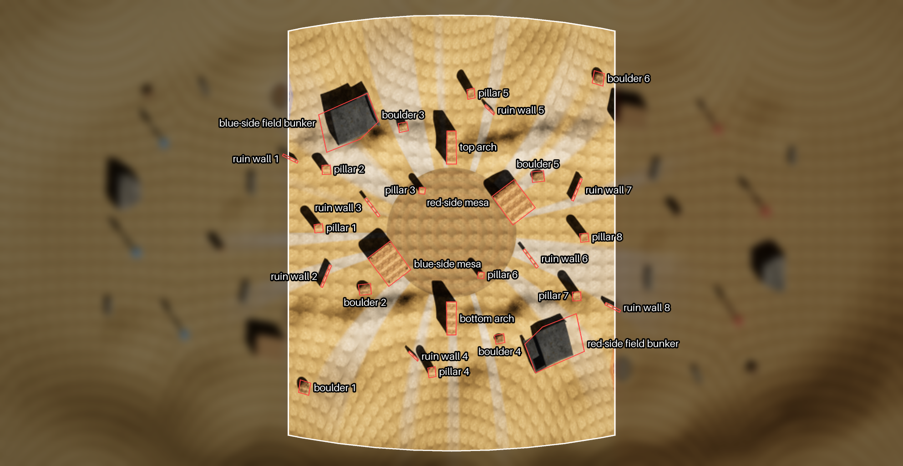
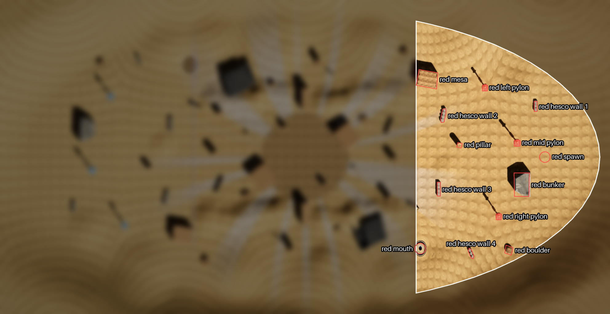

<!-- game_design/worlds/make_world_doc.py writes this file from ../source/. Edit those files, not this one. -->

# Dust

Dust is the outer blue level (depth 2): a desert basin in hyperbolic space (curvature radius 50 m) under a constant
sandstorm whose wind bends light, and so lasers. Each team has three pylons. One fixed wormhole joins the blue zone to
the red zone, and there is no black hole. The zones are bands across the level's length: the blue zone is more than
48 m from the middle on blue's side, the red zone more than 48 m on red's side, and the middle zone lies between.

The pictures are the game's map picture of Dust (`demos/dust_rust/map_pictures/dust_r50m.png`), scaled up twice, with
blue on the left, so left (blue's left) is the top of a picture. Names follow the
[naming rules](../../README.md#naming-rules); the layout is
[`common/maps/dust/map.json`](../../../../common/maps/dust/map.json).



## World tree

```text
Dust
├── blue zone
│   ├── blue spawn
│   ├── blue bunker
│   ├── blue left pylon
│   ├── blue mid pylon
│   ├── blue right pylon
│   ├── blue hesco wall 1
│   ├── blue hesco wall 2
│   ├── blue hesco wall 3
│   ├── blue hesco wall 4
│   ├── blue boulder
│   ├── blue pillar
│   ├── blue mesa
│   └── blue mouth
├── middle zone
│   ├── blue-side field bunker
│   ├── red-side field bunker
│   ├── blue-side mesa
│   ├── red-side mesa
│   ├── top arch
│   ├── bottom arch
│   ├── ruin wall 1
│   ├── ruin wall 2
│   ├── ruin wall 3
│   ├── ruin wall 4
│   ├── ruin wall 5
│   ├── ruin wall 6
│   ├── ruin wall 7
│   ├── ruin wall 8
│   ├── pillar 1
│   ├── pillar 2
│   ├── pillar 3
│   ├── pillar 4
│   ├── pillar 5
│   ├── pillar 6
│   ├── pillar 7
│   ├── pillar 8
│   ├── boulder 1
│   ├── boulder 2
│   ├── boulder 3
│   ├── boulder 4
│   ├── boulder 5
│   └── boulder 6
└── red zone
    ├── red spawn
    ├── red bunker
    ├── red left pylon
    ├── red mid pylon
    ├── red right pylon
    ├── red hesco wall 1
    ├── red hesco wall 2
    ├── red hesco wall 3
    ├── red hesco wall 4
    ├── red boulder
    ├── red pillar
    ├── red mesa
    └── red mouth
```



## Blue zone

Blue's end of the level: everything more than 48 m from the middle on blue's side.



| Name | What it is | Name in the level layout |
| --- | --- | --- |
| **blue spawn** | Where blue's players enter the level. | blue spawn |
| **blue bunker** | The concrete bunker beside blue's spawn. | blue kazemat |
| **blue left pylon** | Blue's pylon on blue's left, as seen from blue's spawn facing red. | blue pylon |
| **blue mid pylon** | Blue's pylon in the middle, as seen from blue's spawn facing red. | blue pylon |
| **blue right pylon** | Blue's pylon on blue's right, as seen from blue's spawn facing red. | blue pylon |
| **blue hesco wall 1** | A row of 3 Hesco blocks, number 1 counting from blue's spawn outward. | hesco block |
| **blue hesco wall 2** | A row of 4 Hesco blocks, number 2 counting from blue's spawn outward. | hesco block |
| **blue hesco wall 3** | A row of 4 Hesco blocks, number 3 counting from blue's spawn outward. | hesco block |
| **blue hesco wall 4** | A row of 3 Hesco blocks, number 4 counting from blue's spawn outward. | hesco block |
| **blue boulder** | The boulder at the top of the blue zone. | boulder |
| **blue pillar** | The sandstone pillar in front of blue's pylons. | sandstone pillar |
| **blue mesa** | The sandstone mesa at the bottom edge of the blue zone. | sandstone mesa |
| **blue mouth** | The blue zone's mouth of the wormhole that leads to the red mouth. | wormhole mouth A |

## Middle zone

The 96 m band across the middle of the level, between the team zones.



| Name | What it is | Name in the level layout |
| --- | --- | --- |
| **blue-side field bunker** | The field bunker on blue's side of the middle. | blue field bunker |
| **red-side field bunker** | The field bunker on red's side of the middle. | red field bunker |
| **blue-side mesa** | The sandstone mesa on blue's side of the centre. | sandstone mesa |
| **red-side mesa** | The sandstone mesa on red's side of the centre. | sandstone mesa |
| **top arch** | The sandstone arch halfway along, at the top of the main map. | sandstone arch |
| **bottom arch** | The sandstone arch halfway along, at the bottom of the main map. | sandstone arch |
| **ruin wall 1** | A broken wall, number 1 counting from blue's side to red's. | ruin wall |
| **ruin wall 2** | A broken wall, number 2 counting from blue's side to red's. | ruin wall |
| **ruin wall 3** | A broken wall, number 3 counting from blue's side to red's. | ruin wall |
| **ruin wall 4** | A broken wall, number 4 counting from blue's side to red's. | ruin wall |
| **ruin wall 5** | A broken wall, number 5 counting from blue's side to red's. | ruin wall |
| **ruin wall 6** | A broken wall, number 6 counting from blue's side to red's. | ruin wall |
| **ruin wall 7** | A broken wall, number 7 counting from blue's side to red's. | ruin wall |
| **ruin wall 8** | A broken wall, number 8 counting from blue's side to red's. | ruin wall |
| **pillar 1** | A sandstone pillar, number 1 counting from blue's side to red's. | sandstone pillar |
| **pillar 2** | A sandstone pillar, number 2 counting from blue's side to red's. | sandstone pillar |
| **pillar 3** | A sandstone pillar, number 3 counting from blue's side to red's. | sandstone pillar |
| **pillar 4** | A sandstone pillar, number 4 counting from blue's side to red's. | sandstone pillar |
| **pillar 5** | A sandstone pillar, number 5 counting from blue's side to red's. | sandstone pillar |
| **pillar 6** | A sandstone pillar, number 6 counting from blue's side to red's. | sandstone pillar |
| **pillar 7** | A sandstone pillar, number 7 counting from blue's side to red's. | sandstone pillar |
| **pillar 8** | A sandstone pillar, number 8 counting from blue's side to red's. | sandstone pillar |
| **boulder 1** | A boulder, number 1 counting from blue's side to red's. | boulder |
| **boulder 2** | A boulder, number 2 counting from blue's side to red's. | boulder |
| **boulder 3** | A boulder, number 3 counting from blue's side to red's. | boulder |
| **boulder 4** | A boulder, number 4 counting from blue's side to red's. | boulder |
| **boulder 5** | A boulder, number 5 counting from blue's side to red's. | boulder |
| **boulder 6** | A boulder, number 6 counting from blue's side to red's. | boulder |

## Red zone

Red's end of the level: everything more than 48 m from the middle on red's side.



| Name | What it is | Name in the level layout |
| --- | --- | --- |
| **red spawn** | Where red's players enter the level. | red spawn |
| **red bunker** | The concrete bunker beside red's spawn. | red kazemat |
| **red left pylon** | Red's pylon on blue's left, as seen from blue's spawn facing red. | red pylon |
| **red mid pylon** | Red's pylon in the middle, as seen from blue's spawn facing red. | red pylon |
| **red right pylon** | Red's pylon on blue's right, as seen from blue's spawn facing red. | red pylon |
| **red hesco wall 1** | A row of 3 Hesco blocks, number 1 counting from red's spawn outward. | hesco block |
| **red hesco wall 2** | A row of 4 Hesco blocks, number 2 counting from red's spawn outward. | hesco block |
| **red hesco wall 3** | A row of 4 Hesco blocks, number 3 counting from red's spawn outward. | hesco block |
| **red hesco wall 4** | A row of 3 Hesco blocks, number 4 counting from red's spawn outward. | hesco block |
| **red boulder** | The boulder at the bottom of the red zone. | boulder |
| **red pillar** | The sandstone pillar in front of red's pylons. | sandstone pillar |
| **red mesa** | The sandstone mesa at the top edge of the red zone. | sandstone mesa |
| **red mouth** | The red zone's mouth of the wormhole that leads to the blue mouth. | wormhole mouth B |
