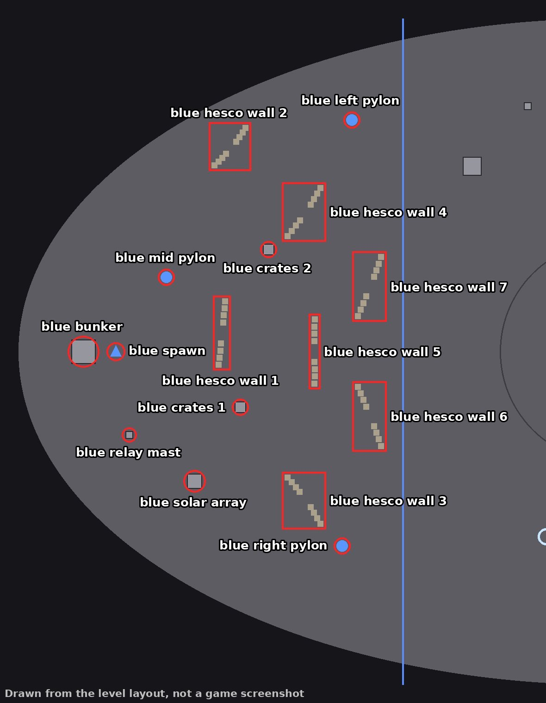
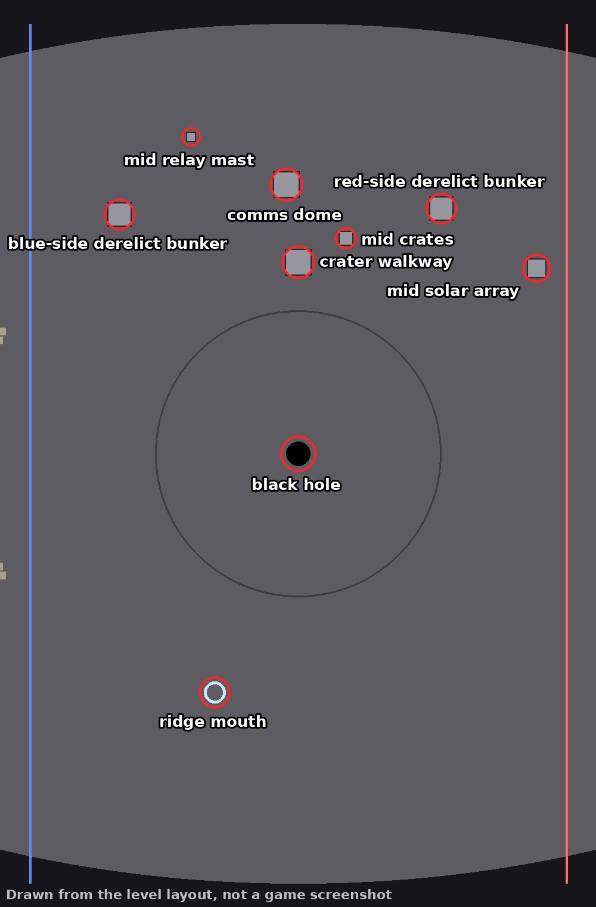
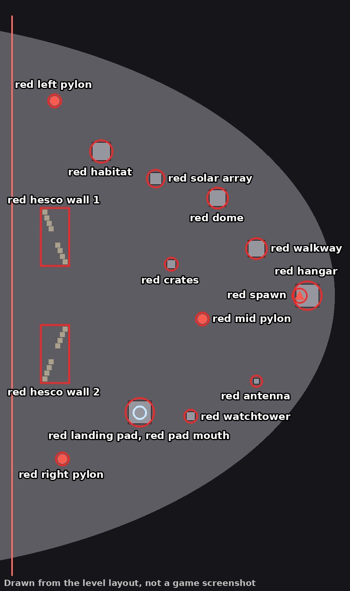

# Lunar Surface

Lunar Surface is the outer red level (depth 2): a lunar base on a regolith plain inside an elliptical crater in
hyperbolic space. The playable area is an ellipse 256 m long and 144 m wide, and the crater's wall around it is the
level edge. Each team has three pylons. A black hole hangs about 7.5 m above the middle of the level, slows time near
it and grows as consoles are turned off, and one fixed wormhole joins a ridge in the middle zone to the red landing
pad. The zones are bands across the level's length: the blue zone is more than 45 m from the middle on blue's side,
the red zone more than 45 m on red's side, and the middle zone, 90 m long, lies between. [`DESIGN.md`](../DESIGN.md#lunar-surface)
describes the level in full.

> NOTE: Lunar Surface has no map picture in the repo yet: making one needs the game's engine, which runs on a Mac.
> These pictures are drawn from the level layout instead, as squares, circles and Hesco blocks on a flat ellipse, and
> say so on the image. Replace them with marked map pictures once the game can make one.

The pictures show blue on the left, so left (blue's left) is the top of a picture. The blue and
red lines are the edges of the team zones, the large circle is how far the black hole bends light, and the triangles
are the spawns. Names follow the [naming rules](README.md#naming-rules); the layout is
[`common/maps/lunar_surface/map.json`](../../common/maps/lunar_surface/map.json).

## World tree

```text
Lunar Surface
├── blue zone
│   ├── blue spawn, blue bunker
│   ├── blue left pylon, blue mid pylon, blue right pylon
│   ├── blue hesco wall 1 to 7
│   ├── blue crates 1, blue crates 2
│   └── blue relay mast, blue solar array
├── middle zone
│   ├── black hole
│   ├── ridge mouth
│   ├── blue-side derelict bunker, red-side derelict bunker
│   ├── comms dome, crater walkway
│   └── mid relay mast, mid crates, mid solar array
└── red zone
    ├── red spawn, red hangar
    ├── red left pylon, red mid pylon, red right pylon
    ├── red hesco wall 1, red hesco wall 2
    ├── red landing pad, red pad mouth
    ├── red habitat, red dome, red walkway
    ├── red watchtower, red antenna
    └── red crates, red solar array
```

## Blue zone



| Name | What it is | Name in the level layout |
| --- | --- | --- |
| **blue spawn** | Where blue's players enter the level. | blue spawn |
| **blue bunker** | The concrete bunker behind blue's spawn, a model players walk into. | blue kazemat |
| **blue left pylon**, **blue mid pylon**, **blue right pylon** | Blue's three pylons, left to right as seen from blue's spawn facing red. | blue pylon |
| **blue hesco wall 1** to **7** | Rows of 8 Hesco blocks, numbered from blue's spawn outward. | hesco block |
| **blue crates 1**, **blue crates 2** | Stacks of supply crates, numbered from blue's spawn outward. | blue supply crates |
| **blue relay mast** | The relay mast beside blue's spawn. | blue relay mast |
| **blue solar array** | The solar array on blue's right, near the spawn. | blue solar array |

## Middle zone



| Name | What it is | Name in the level layout |
| --- | --- | --- |
| **black hole** | The black hole over the middle of the level. | black hole |
| **ridge mouth** | The mouth of the wormhole on the ridge, which leads to the red pad mouth. | wormhole mouth A |
| **blue-side derelict bunker**, **red-side derelict bunker** | The two derelict field bunkers at the top of the middle zone, one on each team's side, models players walk into. | derelict field bunker |
| **comms dome** | The communications dome at the top of the middle zone. | comms dome |
| **crater walkway** | The walkway between the comms dome and the black hole. | crater walkway |
| **mid relay mast** | The relay mast near the top edge of the middle zone. | relay mast |
| **mid crates** | The stack of crates beside the crater walkway. | crates |
| **mid solar array** | The solar array at the top of the middle zone, on red's side. | solar array |

## Red zone



| Name | What it is | Name in the level layout |
| --- | --- | --- |
| **red spawn** | Where red's players enter the level. | red spawn |
| **red hangar** | The bunker garage that red's spawn is in. | red spawn hangar |
| **red left pylon**, **red mid pylon**, **red right pylon** | Red's three pylons, left to right as seen from blue's spawn facing red. | red pylon |
| **red hesco wall 1**, **red hesco wall 2** | The two rows of 8 Hesco blocks near the edge of the red zone. | hesco block |
| **red landing pad** | The landing pad on blue's right. | red landing pad |
| **red pad mouth** | The mouth of the wormhole on the landing pad, which leads to the ridge mouth. | wormhole mouth B |
| **red habitat** | The habitat module on blue's left, with glass windows. | red habitat module |
| **red dome** | The dome on blue's left, near the spawn. | red dome |
| **red walkway** | The walkway near red's spawn, with glass windows. | red walkway |
| **red watchtower** | The watchtower on blue's right, beside the landing pad. | red watchtower |
| **red antenna** | The antenna near red's spawn, on blue's right. | red antenna |
| **red crates** | The stack of crates in front of red's mid pylon. | red crates |
| **red solar array** | The solar array on blue's left. | red solar array |
