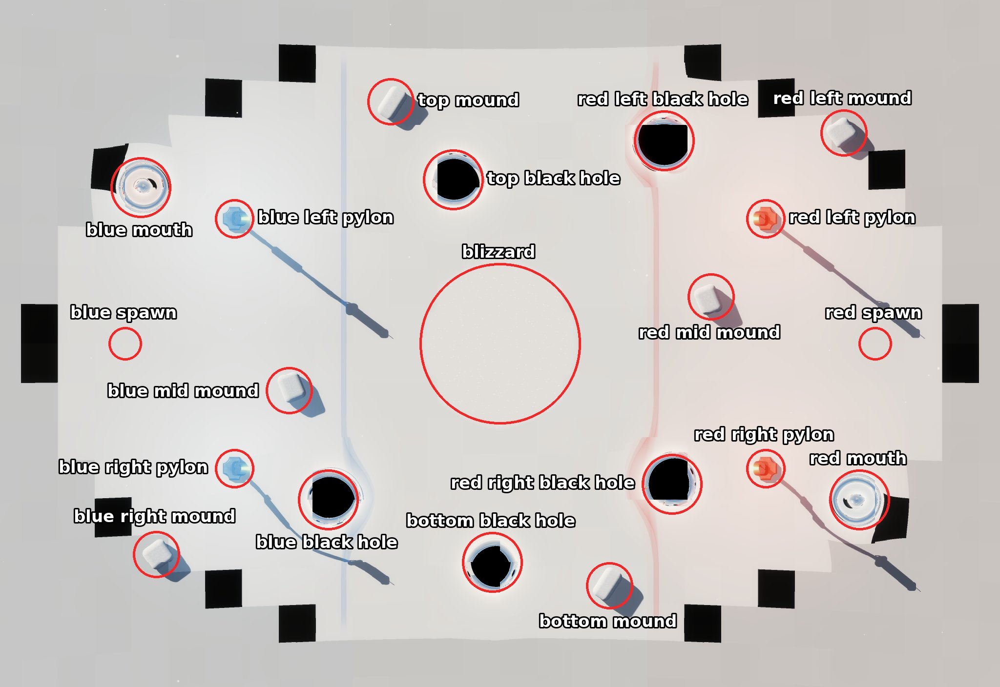

# Snow Planet

Snow Planet is the inner blue level (depth 1): an open snow field in flat space whose soft level edge slows players
without end, with light snowfall and fog. Each team has two pylons. Five black holes and one fixed wormhole bend the
field, six rounded snow mounds give cover, and a tall blizzard stands in the middle. The zones are bands across the
level's length: the blue zone is more than 20 m from the middle on blue's side, the red zone more than 20 m on red's
side, and the middle zone lies between.

The picture marks the game's map picture of Snow Planet (`demos/snow_planet_rust/map_pictures/snow_planet.png`), with
blue on the left, so left (blue's left) is the top of the picture. Names follow the
[naming rules](README.md#naming-rules); the layout is
[`common/maps/snow_planet/map.json`](../../common/maps/snow_planet/map.json).



## World tree

```text
Snow Planet
├── blue zone
│   ├── blue spawn
│   ├── blue left pylon, blue right pylon
│   ├── blue mid mound, blue right mound
│   ├── blue black hole
│   └── blue mouth
├── middle zone
│   ├── blizzard
│   ├── top black hole, bottom black hole
│   └── top mound, bottom mound
└── red zone
    ├── red spawn
    ├── red left pylon, red right pylon
    ├── red mid mound, red left mound
    ├── red left black hole, red right black hole
    └── red mouth
```

## Blue zone

| Name | What it is | Name in the level layout |
| --- | --- | --- |
| **blue spawn** | Where blue's players enter the level. | blue spawn |
| **blue left pylon**, **blue right pylon** | Blue's two pylons, left and right as seen from blue's spawn facing red. | blue pylon |
| **blue mid mound** | The snow mound in front of blue's spawn. | blue snow mound |
| **blue right mound** | The snow mound behind blue's right pylon. | blue snow mound |
| **blue black hole** | The black hole on blue's right, at the edge of the blue zone. | black hole north-west |
| **blue mouth** | The blue zone's mouth of the wormhole that leads to the red mouth. | wormhole mouth A |

## Middle zone

| Name | What it is | Name in the level layout |
| --- | --- | --- |
| **blizzard** | The tall column of snow and fog in the middle, 10 m in radius and 16 m high. A player inside it moves at half speed and slowly loses health, and a shot goes at most 8 m inside it. | white-out |
| **top black hole**, **bottom black hole** | The two black holes of the middle zone, at the top and bottom of the main map. | black hole south-west, black hole north |
| **top mound**, **bottom mound** | The two snow mounds of the middle zone. | blue snow mound, red snow mound |

## Red zone

| Name | What it is | Name in the level layout |
| --- | --- | --- |
| **red spawn** | Where red's players enter the level. | red spawn |
| **red left pylon**, **red right pylon** | Red's two pylons, left and right as seen from blue's spawn facing red. | red pylon |
| **red mid mound** | The snow mound in front of red's spawn. | red snow mound |
| **red left mound** | The snow mound behind the red left pylon. | red snow mound |
| **red left black hole**, **red right black hole** | The two black holes at the edge of the red zone, left and right as seen from blue's spawn. | black hole south-east, black hole north-east |
| **red mouth** | The red zone's mouth of the wormhole that leads to the blue mouth. | wormhole mouth B |

The layout's compass names for the black holes don't match the main map's top and bottom; the world names are the
official ones.
